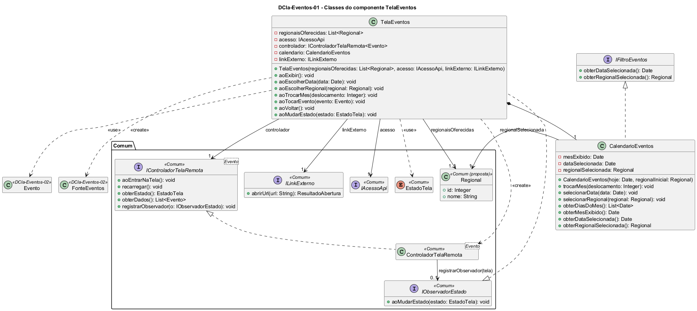

# DCla-Eventos-01 – Classes do componente TelaEventos

| Campo | Valor |
|---|---|
| **Código** | `DCla-Eventos-01` |
| **Título** | Classes do componente TelaEventos |
| **Autor(a)** | José Eduardo Gontijo de Carvalho (Pessoa C) |
| **Revisor(a)** | Phablo Tavares Paixão (Pessoa D) |
| **Status** | Em produção |
| **Rastreia para** | `DCmp-Eventos-01`, `DCla-Eventos-02`, `DCla-Comum-01`, `DCla-Comum-02`, `DCla-Comum-03`, `DIhc-Eventos-01`, `DSeq-Eventos-01`, `DEst-Eventos-01`, `Contrato-Eventos-01`, `DD-Eventos-01` |

## Diagrama

Fonte: [`DCla-Eventos-01.puml`](DCla-Eventos-01.puml)

## Descrição

Classes do componente TelaEventos.

- **TelaEventos** representa a tela. Cada método `ao...` corresponde a um evento de interação do protótipo (`DIhc-Eventos-01`): `aoExibir` (E0, entrada e retorno), `aoEscolherRegional` (E1), `aoTrocarMes` (E2 e E3), `aoEscolherData` (E4), `aoTocarEvento` (E5) e `aoVoltar` (E6). Implementa `IObservadorEstado` (pacote Comum, `DCla-Comum-03`) e, em `aoMudarEstado`, mostra a lista de cartões (lida com `controlador.obterDados()`) junto com a faixa de abas de regional, a mensagem "Sem eventos" (sem a faixa de abas), a de indisponibilidade ou o indicador de carregamento. O calendário (setas, mês, ano, dias, dia selecionado) é desenhado a partir de `CalendarioEventos` e fica visível nos estados de resultado (capturas 19 e 29, P-EV-1 e P-EV-10); a tela posiciona o dia 1 na coluna do dia da semana, deixando vazias as células anteriores.
  - **`regionaisOferecidas: List<Regional>`:** lista de regionais mostradas como abas, recebida na construção; a regional inicial é a primeira da lista (P-EV-2). Só a aba "GOIÂNIA" foi observada. A faixa de abas só existe no estado `EXIBINDO`, e por isso `aoEscolherRegional` (E1) só é chamada nesse estado.
  - **Criação e registro.** Na primeira exibição (entrada pelo menu), `aoExibir` cria o `CalendarioEventos` com a data de hoje (P-EV-6) e a regional inicial, cria a `FonteEventos` (`DCla-Eventos-02`) com o `acesso` e o calendário, cria o `ControladorTelaRemota<Evento>` do Comum com essa fonte e **se registra como observador** do controlador (`controlador.registrarObservador(this)`); depois chama `controlador.aoEntrarNaTela()`. No retorno do Navegador esses objetos são mantidos, e o filtro também (`DSeq-Eventos-01` e `DSeq-Eventos-05`).
  - **`aoVoltar`:** encerra a tela e descarta o calendário (filtro) e os eventos em memória.
- **IControladorTelaRemota\<Evento\>** (Comum) aparece com todas as suas operações atuais (`aoEntrarNaTela`, `recarregar`, `obterEstado`, `obterDados`, `registrarObservador`); a tela usa `aoEntrarNaTela`, `recarregar`, `obterDados` e `registrarObservador`.
- **CalendarioEventos** guarda o mês exibido, a data selecionada e a regional selecionada, e oferece a lista de dias do mês para desenhar o calendário. Implementa `IFiltroEventos`, interface que a `FonteEventos` usa para ler a data e a regional (`DCla-Eventos-02`). `trocarMes` **mantém o número do dia selecionado** no novo mês (30 de outubro, 30 de novembro, 30 de dezembro, capturas 19, 28 e 29: P-EV-7); quando o novo mês é mais curto que o dia, a premissa de projeto é ajustar para o último dia do mês (P-EV-8, não observada). A premissa antiga de selecionar o dia 1 foi refutada (P-EV-3 no README).
- **Regional** é entidade de dono Pessoa C, compartilhada com Notícias e Locais (`DD-Eventos-01`). Aparece aqui só como referência; sua localização no `DPac-Geral-01` é pendência da integração, e a proposta da Pessoa C é mantê-la em `Comum`.

As classes e interfaces dos estereótipos `<<Comum>>` pertencem ao pacote Comum e não são redefinidas aqui. Os contratos das operações estão em `Contrato-Eventos-01`. As premissas P-EV-1, P-EV-2, P-EV-6, P-EV-7, P-EV-8 e P-EV-10 estão na tabela de [`Eventos/README.md`](README.md), com a situação de cada uma nas capturas.

## Referências

INSTITUTE OF ELECTRICAL AND ELECTRONICS ENGINEERS. **Guide to the Software Engineering Body of Knowledge – SWEBOK v4**. Cap. 3 (Software Design). IEEE, 2024.

ANTHROPIC. **Claude Code**. Assistente de IA. Disponível em: claude.ai/code. Acesso em: 30 out. 2026. Uso: apoio à redação e aos diagramas, a partir das instruções, das capturas de tela e das correções do autor (resumo em `IA/registro-C.md`). Questão: Apêndice <X>, Seção <X.1>.

---

## Registro de revisão

| Data | Revisor(a) | Situação | Observações |
|---|---|---|---|
| | | | |
