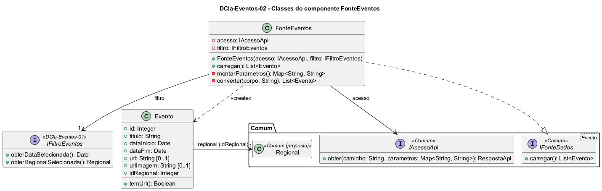

# DCla-Eventos-02 – Classes do componente FonteEventos

| Campo | Valor |
|---|---|
| **Código** | `DCla-Eventos-02` |
| **Título** | Classes do componente FonteEventos |
| **Autor(a)** | José Eduardo Gontijo de Carvalho (Pessoa C) |
| **Revisor(a)** | Phablo Tavares Paixão (Pessoa D) |
| **Status** | Em produção |
| **Rastreia para** | `DCmp-Eventos-01`, `DCla-Comum-02`, `DCla-Comum-03`, `DCla-Eventos-01`, `DSeq-Eventos-01`, `DSeq-Eventos-05`, `Contrato-Eventos-01`, `DD-Eventos-01` |

## Diagrama

Fonte: [`DCla-Eventos-02.puml`](DCla-Eventos-02.puml)

## Descrição

Classes do componente FonteEventos.

- **FonteEventos** implementa a interface `IFonteDados<Evento>` do pacote Comum (`DCla-Comum-03`). Em `carregar()`, lê a data e a regional pela `IFiltroEventos`, monta os parâmetros (`regional` e `data`), consulta a API com `IAcessoApi.obter("/eventos", ...)` (`DCla-Comum-02`) e converte o JSON em uma lista de `Evento`, que mantém a ordem recebida (a ordem da lista na tela não é conhecida: P-EV-14). Não trata falhas: o `ErroApi` lançado pelo acesso à API segue até o controlador de estados, que define o estado Indisponível.
- **Evento** é a entidade exibida na lista. O cartão do evento mostra uma miniatura circular, o título e o período "dd/mm/aaaa à dd/mm/aaaa" (capturas 19 e 28, P-EV-1); por isso `Evento` tem título, período (data de início e de fim, que pode ser a mesma), `urlImagem` (endereço opcional da miniatura), endereço opcional da página (`url`) e a regional (`idRegional`). `temUrl()` diz se o toque no evento abre o Navegador; sem endereço, o toque não tem efeito (P-EV-4). Atributos completos no dicionário de dados (`DD-Eventos-01`).
- **Nota sobre `urlImagem`.** A miniatura aparece em todos os cartões vistos; como a tela precisa de um dado de onde tirá-la, o atributo foi acrescentado ao modelo. É opcional porque não se sabe se todo evento tem imagem nem o que o cartão mostra sem ela (P-EV-1).
- **Nota sobre o local.** A página do evento no portal da UFG mostra o local ("Centro de Línguas, Câmpus Samambaia", captura 8; "Biblioteca Seccional Cepae Prof. Geraldo Faria Campos, Campus Samambaia", captura 21, versão 3.2.0), mas o cartão da lista não o mostra (capturas 19 e 28). Por isso `Evento` não tem o atributo `local`.
- A conversão do JSON em objetos fica nesta fonte, e não no pacote Comum, porque só a funcionalidade conhece o formato (`DCla-Comum-02`). A rota `/eventos` e o formato da resposta, inclusive o endereço da miniatura, são premissa de projeto (P-EV-5): o app real não deixa o contrato da API visível.

Os contratos das operações estão em `Contrato-Eventos-01`. As premissas P-EV-1, P-EV-4, P-EV-5 e P-EV-14 estão na tabela de [`Eventos/README.md`](README.md).

## Referências

INSTITUTE OF ELECTRICAL AND ELECTRONICS ENGINEERS. **Guide to the Software Engineering Body of Knowledge – SWEBOK v4**. Cap. 3 (Software Design). IEEE, 2024.

ANTHROPIC. **Claude Code**. Assistente de IA. Disponível em: claude.ai/code. Acesso em: 30 out. 2026. Uso: apoio à redação e aos diagramas, a partir das instruções, das capturas de tela e das correções do autor (resumo em `IA/registro-C.md`). Questão: Apêndice <X>, Seção <X.1>.

---

## Registro de revisão

| Data | Revisor(a) | Situação | Observações |
|---|---|---|---|
| | | | |
