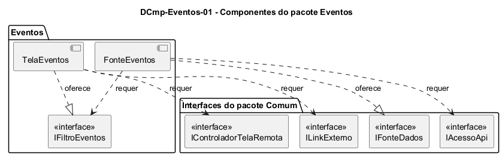

# DCmp-Eventos-01 – Componentes do pacote Eventos

| Campo | Valor |
|---|---|
| **Código** | `DCmp-Eventos-01` |
| **Título** | Componentes do pacote Eventos |
| **Autor(a)** | José Eduardo Gontijo de Carvalho (Pessoa C) |
| **Revisor(a)** | Phablo Tavares Paixão (Pessoa D) |
| **Status** | Em produção (primeira versão) |
| **Rastreia para** | `DPac-Geral-01`, `DCmp-Comum-01`, `DCla-Eventos-01`, `DCla-Eventos-02`, `DSeq-Eventos-01` |

## Diagrama

Fonte: [`DCmp-Eventos-01.puml`](DCmp-Eventos-01.puml)

## Descrição

O pacote `Eventos` tem dois componentes. Eles dependem do pacote `Comum` apenas por interfaces, como pede o `DPac-Geral-01`, e não dependem de nenhum outro pacote de funcionalidade.

**Tabela 1 – Componentes do pacote Eventos**

| Componente | Responsabilidade | Interface oferecida | Interfaces requeridas (pacote Comum) | Classes |
|---|---|---|---|---|
| TelaEventos | Exibe o calendário, o seletor de regional e a lista; guarda a data e a regional selecionadas; trata os toques do usuário | `IFiltroEventos` | `IControladorTelaRemota`, `ILinkExterno` | `DCla-Eventos-01` |
| FonteEventos | Busca os eventos da regional e da data selecionadas na API e os converte em objetos `Evento` | `IFonteDados` (implementada para `Evento`) | `IAcessoApi`, `IFiltroEventos` | `DCla-Eventos-02` |

**Como os componentes cooperam.** A `TelaEventos` cria um controlador de estados (`ControladorTelaRemota<Evento>`, pacote Comum) e entrega a ele a `FonteEventos` como fonte de dados. Quando a data ou a regional mudam, a tela pede `recarregar()` ao controlador, e a `FonteEventos` lê o novo filtro pela interface `IFiltroEventos`. Esse desenho segue o modelo de uso descrito em `DCmp-Comum-01`.

**Decisão de projeto.** O estado do filtro (mês exibido, data e regional) fica na tela, no `CalendarioEventos`, e é lido pela fonte de dados por uma interface. Assim, a fonte não conhece a interface gráfica e pode ser testada sozinha.

As premissas `P-EV-n` citadas estão listadas, com o que falta confirmar nas capturas de tela do app, em [`Eventos/README.md`](README.md).

## Referências

INSTITUTE OF ELECTRICAL AND ELECTRONICS ENGINEERS. **Guide to the Software Engineering Body of Knowledge – SWEBOK v4**. Cap. 3 (Software Design). IEEE, 2024.

---

## Registro de revisão

| Data | Revisor(a) | Situação | Observações |
|---|---|---|---|
| | | | |
