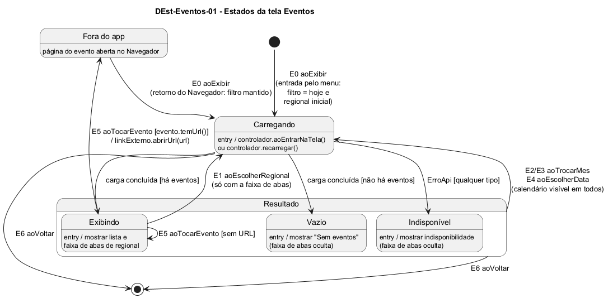

# DEst-Eventos-01 – Estados da tela Eventos

| Campo | Valor |
|---|---|
| **Código** | `DEst-Eventos-01` |
| **Título** | Estados da tela Eventos |
| **Autor(a)** | José Eduardo Gontijo de Carvalho (Pessoa C) |
| **Revisor(a)** | Phablo Tavares Paixão (Pessoa D) |
| **Status** | Em produção |
| **Rastreia para** | `DIhc-Eventos-01`, `DEst-Comum-01`, `DCla-Comum-03`, `DSeq-Eventos-01`, `DSeq-Eventos-02`, `DSeq-Eventos-03`, `DSeq-Eventos-04`, `DSeq-Eventos-05`, `ECA-Eventos-01` |

## Diagrama

Fonte: [`DEst-Eventos-01.puml`](DEst-Eventos-01.puml)

## Descrição

Especifica como a tela Eventos reage a cada evento de interação do protótipo (`DIhc-Eventos-01`, rótulos E0 a E6). Os estados Carregando, Exibindo, Vazio e Indisponível são os do ciclo genérico de `DEst-Comum-01`. Aqui, Exibindo, Vazio e Indisponível ficam reunidos no estado composto `Resultado`. Dos quatro, foram observados o estado Exibindo (capturas 19 e 28) e o estado Vazio (captura 29: ilustração, "Sem eventos" e "Não há eventos para esse dia!", P-EV-10); Carregando e Indisponível não foram capturados em Eventos (P-EV-11) e seguem o ciclo genérico. A tela de Eventos acrescenta:

- as ações que levam a nova carga, que mudam o filtro e por isso levam a Carregando: **E2** e **E3** trocar o mês (`DSeq-Eventos-04`, P-EV-7 e P-EV-8) e **E4** escolher data (`DSeq-Eventos-02`, P-EV-12) saem de **qualquer estado de resultado**, porque o calendário continua visível mesmo sem eventos (capturas 19 e 29); **E1** escolher regional (`DSeq-Eventos-03`, P-EV-2) sai **somente de Exibindo**, porque a faixa de abas de regional só aparece com a lista exibida e some no estado Vazio (captura 29). No estado Indisponível supõe-se o calendário visível e a faixa de abas oculta, o que não foi observado (P-EV-11). Se cada troca consulta o servidor ou filtra em memória não é observável (P-EV-13);
- o estado **Fora do app**: ao tocar em um evento com endereço (**E5**, `DSeq-Eventos-05`), o Navegador é aberto e o app fica em segundo plano. Um toque em evento sem endereço não muda de estado (P-EV-4). Ao voltar, a tela é exibida de novo (**E0**, retorno) e leva a Carregando, e os dados são buscados de novo (sem cache, `ECA-EV-03`). **O filtro (data e regional) é mantido no retorno do Navegador**; ele só é reiniciado (data de hoje e regional inicial, P-EV-2 e P-EV-6) na entrada pelo menu inicial (E0 inicial, `DSeq-Eventos-01`). Como o Navegador é externo, a tela só é exibida de novo a partir de Fora do app;
- **E6** (seta de voltar, `aoVoltar`): encerra a tela a partir de Carregando ou de qualquer estado de resultado; o estado do filtro e os eventos em memória são descartados (`ECA-EV-04`). Não há E6 em Fora do app, pois a seta pertence à tela do app.

**Tabela 1 – Transições da tela Eventos**

| Origem | Evento | Condição | Destino |
|---|---|---|---|
| (início) | E0 `aoExibir` (entrada pelo menu) | filtro reiniciado: hoje e regional inicial | Carregando |
| Carregando | carga concluída | há eventos | Exibindo |
| Carregando | carga concluída | não há eventos | Vazio |
| Carregando | `ErroApi` | qualquer tipo | Indisponível |
| Exibindo | E1 `aoEscolherRegional` | a faixa de abas só existe nesse estado | Carregando |
| Resultado (Exibindo, Vazio ou Indisponível) | E2 ou E3 `aoTrocarMes`, E4 `aoEscolherData` | o calendário está visível em todos os estados de resultado | Carregando |
| Exibindo | E5 `aoTocarEvento` | o evento tem URL | Fora do app |
| Exibindo | E5 `aoTocarEvento` | o evento não tem URL | Exibindo |
| Fora do app | E0 `aoExibir` (retorno do Navegador) | filtro mantido | Carregando |
| Carregando ou Resultado | E6 `aoVoltar` | – | (fim) |

Regras associadas: `ECA-EV-01` a `ECA-EV-04` (`ECA-Eventos-01`). As premissas P-EV-1, P-EV-2, P-EV-4, P-EV-6, P-EV-7, P-EV-8, P-EV-10, P-EV-11, P-EV-12 e P-EV-13 estão na tabela de [`Eventos/README.md`](README.md), com a situação de cada uma nas capturas.

## Referências

INSTITUTE OF ELECTRICAL AND ELECTRONICS ENGINEERS. **Guide to the Software Engineering Body of Knowledge – SWEBOK v4**. Cap. 11 (Software Engineering Models and Methods). IEEE, 2024.

ANTHROPIC. **Claude Code**. Assistente de IA. Disponível em: claude.ai/code. Acesso em: 30 out. 2026. Uso: apoio à redação e aos diagramas, a partir das instruções, das capturas de tela e das correções do autor (resumo em `IA/registro-C.md`). Questão: Apêndice <X>, Seção <X.1>.

---

## Registro de revisão

| Data | Revisor(a) | Situação | Observações |
|---|---|---|---|
| | | | |
