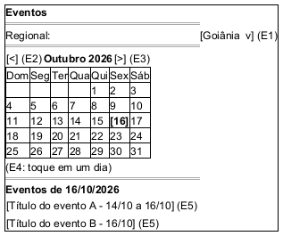

# DIhc-Eventos-01 – Protótipo da tela Eventos

| Campo | Valor |
|---|---|
| **Código** | `DIhc-Eventos-01` |
| **Título** | Protótipo da tela Eventos |
| **Autor(a)** | José Eduardo Gontijo de Carvalho (Pessoa C) |
| **Revisor(a)** | Phablo Tavares Paixão (Pessoa D) |
| **Status** | Em produção (primeira versão) |
| **Rastreia para** | `DCdu-Eventos-01`, `DAtv-Eventos-01`, `DAtv-Eventos-02`, `DAtv-Eventos-03`, `DEst-Eventos-01`, `DCla-Eventos-01` |

## Diagrama

Fonte: [`DIhc-Eventos-01.puml`](DIhc-Eventos-01.puml)

## Descrição

Protótipo da tela Eventos, desenhado em PlantUML Salt a partir do que o app atual mostra: seletor de regional, calendário mensal com setas para trocar de mês, e a lista de eventos da data selecionada. Os rótulos `(E1)` a `(E5)` identificam os eventos de interação, tratados em `DEst-Eventos-01`. Os dados do desenho são ilustrativos. Os desfechos "sem eventos" e "indisponível" mostram, no lugar da lista, a mensagem correspondente (`DEst-Comum-01`).

**Tabela 1 – Eventos de interação da tela**

| Rótulo | Elemento | Gesto | Efeito | Atividade |
|---|---|---|---|---|
| E0 | Tela (ao ser exibida) | Entrada na tela | Carrega os eventos de hoje na regional inicial | `DSeq-Eventos-01` |
| E1 | Seletor de regional | Toque e escolha de uma opção | Seleciona a regional e recarrega a lista | `DSeq-Eventos-03` |
| E2 | Seta de mês anterior | Toque | Mostra o mês anterior, seleciona o dia 1 e recarrega | `DSeq-Eventos-04` |
| E3 | Seta de mês seguinte | Toque | Mostra o mês seguinte, seleciona o dia 1 e recarrega | `DSeq-Eventos-04` |
| E4 | Dia do calendário | Toque | Seleciona a data e recarrega a lista | `DSeq-Eventos-02` |
| E5 | Evento da lista | Toque | Abre a página do evento no Navegador, se houver endereço | `DSeq-Eventos-05` |

O evento E0 ocorre sempre que a tela é exibida, inclusive ao voltar de outra tela ou do Navegador, pois o app não guarda cache.

As premissas `P-EV-n` citadas estão listadas, com o que falta confirmar nas capturas de tela do app, em [`Eventos/README.md`](README.md).

## Referências

INSTITUTE OF ELECTRICAL AND ELECTRONICS ENGINEERS. **Guide to the Software Engineering Body of Knowledge – SWEBOK v4**. Cap. 11 (Software Engineering Models and Methods). IEEE, 2024.

---

## Registro de revisão

| Data | Revisor(a) | Situação | Observações |
|---|---|---|---|
| | | | |
