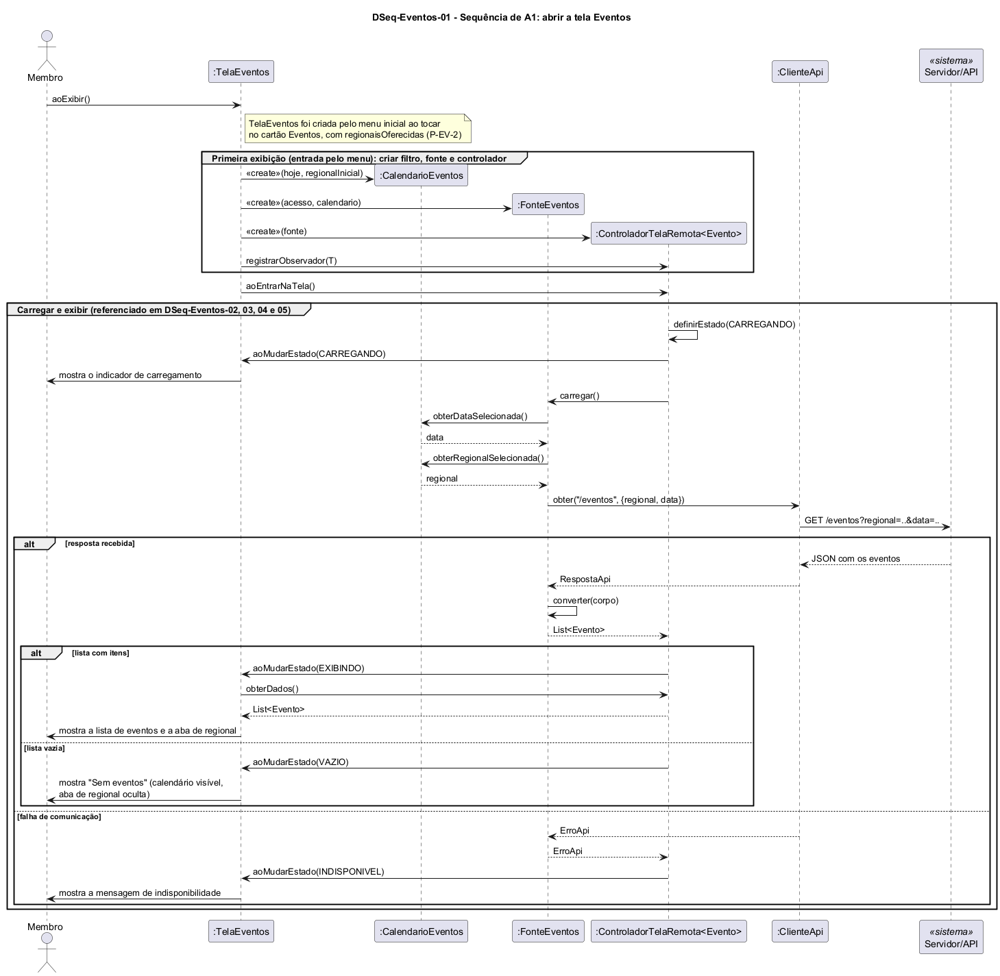

# DSeq-Eventos-01 – Sequência de A1: abrir a tela Eventos

| Campo | Valor |
|---|---|
| **Código** | `DSeq-Eventos-01` |
| **Título** | Sequência de A1: abrir a tela Eventos |
| **Autor(a)** | José Eduardo Gontijo de Carvalho (Pessoa C) |
| **Revisor(a)** | Phablo Tavares Paixão (Pessoa D) |
| **Status** | Em produção |
| **Rastreia para** | `DAtv-Eventos-01`, `DIhc-Eventos-01`, `DCla-Eventos-01`, `DCla-Eventos-02`, `Contrato-Eventos-01`, `DCla-Comum-02`, `DCla-Comum-03`, `DEst-Comum-01` |

## Diagrama

Fonte: [`DSeq-Eventos-01.puml`](DSeq-Eventos-01.puml)

## Descrição

Detalha a atividade A1 de `DAtv-Eventos-01` (evento E0 de `DIhc-Eventos-01`): o usuário abre a tela e o app carrega os eventos de hoje na regional inicial (P-EV-2, P-EV-6). A primeira mensagem é a operação `aoExibir()` da `TelaEventos`. A tela foi criada pelo menu inicial ao toque no cartão Eventos, recebendo `regionaisOferecidas`. Na primeira exibição (entrada pelo menu) ela cria o `CalendarioEventos` com a data de hoje e a primeira regional da lista, cria a `FonteEventos` com o acesso à API e o calendário (que faz o papel de `IFiltroEventos`), cria o `ControladorTelaRemota<Evento>` do Comum com essa fonte e se registra nele como observador (`registrarObservador`). Só então chama `aoEntrarNaTela()` (`DCla-Comum-03`).

O controlador pede a carga à `FonteEventos`, que lê a data e a regional selecionadas, consulta a API por meio de `IAcessoApi` (`DCla-Comum-02`) e converte a resposta em eventos. O desfecho define o estado da tela: `EXIBINDO` (a tela lê a lista com `obterDados()` e mostra também a aba de regional), `VAZIO` ("Sem eventos" e "Não há eventos para esse dia!", com o calendário visível e a aba de regional oculta, como na captura 29: P-EV-10) ou `INDISPONIVEL` (qualquer `ErroApi`, tratado no controlador; não capturado em Eventos: P-EV-11). A rota `/eventos` e seus parâmetros são premissa de projeto (P-EV-5), e se o app consulta a API a cada troca de filtro não é observável (P-EV-13). O mesmo grupo "Carregar e exibir" é referenciado nos diagramas `DSeq-Eventos-02` a `05`. Os contratos das operações estão em `Contrato-Eventos-01`.

A situação das premissas citadas (P-EV-2, P-EV-5, P-EV-6, P-EV-10, P-EV-11 e P-EV-13) está na tabela de [`Eventos/README.md`](README.md).

## Referências

INSTITUTE OF ELECTRICAL AND ELECTRONICS ENGINEERS. **Guide to the Software Engineering Body of Knowledge – SWEBOK v4**. Cap. 3 (Software Design). IEEE, 2024.

ANTHROPIC. **Claude Code**. Assistente de IA. Disponível em: claude.ai/code. Acesso em: 30 out. 2026. Uso: apoio à redação e aos diagramas, a partir das instruções, das capturas de tela e das correções do autor (resumo em `IA/registro-C.md`). Questão: Apêndice <X>, Seção <X.1>.

---

## Registro de revisão

| Data | Revisor(a) | Situação | Observações |
|---|---|---|---|
| | | | |
