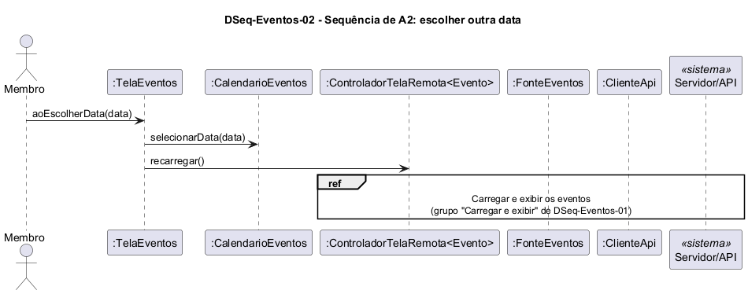

# DSeq-Eventos-02 – Sequência de A2: escolher outra data

| Campo | Valor |
|---|---|
| **Código** | `DSeq-Eventos-02` |
| **Título** | Sequência de A2: escolher outra data |
| **Autor(a)** | José Eduardo Gontijo de Carvalho (Pessoa C) |
| **Revisor(a)** | Phablo Tavares Paixão (Pessoa D) |
| **Status** | Em produção |
| **Rastreia para** | `DAtv-Eventos-01`, `DIhc-Eventos-01`, `DSeq-Eventos-01`, `DCla-Eventos-01`, `Contrato-Eventos-01`, `DCla-Comum-03`, `DEst-Eventos-01` |

## Diagrama

Fonte: [`DSeq-Eventos-02.puml`](DSeq-Eventos-02.puml)

## Descrição

Detalha a atividade A2 de `DAtv-Eventos-01` (evento E4 de `DIhc-Eventos-01`). A primeira mensagem é a operação `aoEscolherData(data)` da `TelaEventos`. A tela atualiza a data no `CalendarioEventos` e pede `recarregar()` ao controlador de estados, que repete o ciclo de carga descrito em `DSeq-Eventos-01`. A regional selecionada não muda. O calendário de dias, com o dia selecionado marcado por um círculo branco, é observado (capturas 19, 28 e 29, P-EV-1); o toque em um dia não foi capturado, só o resultado, e por isso é a premissa P-EV-12. O calendário continua visível sem eventos (P-EV-10), então a operação também vale no estado vazio. Se o app consulta a API a cada troca de dia não é observável (P-EV-13). A situação das premissas está em [`Eventos/README.md`](README.md).

## Referências

INSTITUTE OF ELECTRICAL AND ELECTRONICS ENGINEERS. **Guide to the Software Engineering Body of Knowledge – SWEBOK v4**. Cap. 3 (Software Design). IEEE, 2024.

ANTHROPIC. **Claude Code**. Assistente de IA. Disponível em: claude.ai/code. Acesso em: 30 out. 2026. Uso: apoio à redação e aos diagramas, a partir das instruções, das capturas de tela e das correções do autor (resumo em `IA/registro-C.md`). Questão: Apêndice <X>, Seção <X.1>.

---

## Registro de revisão

| Data | Revisor(a) | Situação | Observações |
|---|---|---|---|
| | | | |
