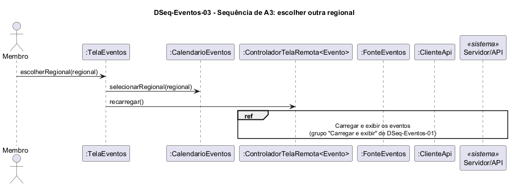

# DSeq-Eventos-03 – Sequência de A3: escolher outra regional

| Campo | Valor |
|---|---|
| **Código** | `DSeq-Eventos-03` |
| **Título** | Sequência de A3: escolher outra regional |
| **Autor(a)** | José Eduardo Gontijo de Carvalho (Pessoa C) |
| **Revisor(a)** | Phablo Tavares Paixão (Pessoa D) |
| **Status** | Em produção (primeira versão) |
| **Rastreia para** | `DAtv-Eventos-01`, `DSeq-Eventos-01`, `DCla-Eventos-01`, `DCla-Comum-03`, `DEst-Eventos-01` |

## Diagrama

Fonte: [`DSeq-Eventos-03.puml`](DSeq-Eventos-03.puml)

## Descrição

Detalha a atividade A3 de `DAtv-Eventos-01` (evento E1 do protótipo). A tela atualiza a regional no `CalendarioEventos` e pede `recarregar()` ao controlador, que repete o ciclo de carga de `DSeq-Eventos-01`. A data selecionada não muda.

As premissas `P-EV-n` citadas estão listadas, com o que falta confirmar nas capturas de tela do app, em [`Eventos/README.md`](README.md).

## Referências

INSTITUTE OF ELECTRICAL AND ELECTRONICS ENGINEERS. **Guide to the Software Engineering Body of Knowledge – SWEBOK v4**. Cap. 3 (Software Design). IEEE, 2024.

---

## Registro de revisão

| Data | Revisor(a) | Situação | Observações |
|---|---|---|---|
| | | | |
