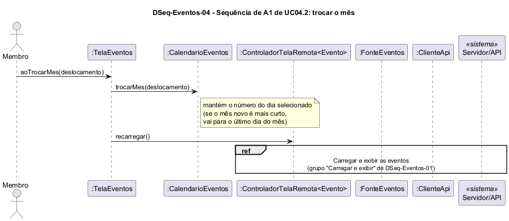

# DSeq-Eventos-04 – Sequência de A1 de UC04.2: trocar o mês

| Campo | Valor |
|---|---|
| **Código** | `DSeq-Eventos-04` |
| **Título** | Sequência de A1 de UC04.2: trocar o mês |
| **Autor(a)** | José Eduardo Gontijo de Carvalho (Pessoa C) |
| **Revisor(a)** | Phablo Tavares Paixão (Pessoa D) |
| **Status** | Em produção |
| **Rastreia para** | `DAtv-Eventos-02`, `DIhc-Eventos-01`, `DSeq-Eventos-01`, `DCla-Eventos-01`, `Contrato-Eventos-01`, `DCla-Comum-03`, `DEst-Eventos-01` |

## Diagrama

Fonte: [`DSeq-Eventos-04.puml`](DSeq-Eventos-04.puml)

## Descrição

Detalha a atividade A1 de `DAtv-Eventos-02` (eventos E2 e E3 de `DIhc-Eventos-01`). A primeira mensagem é a operação `aoTrocarMes(deslocamento)` da `TelaEventos`. O `deslocamento` é -1 (mês anterior) ou +1 (mês seguinte). `CalendarioEventos.trocarMes` muda o mês exibido e **mantém o número do dia selecionado**: nas capturas 19, 28 e 29 o dia 30 continua selecionado em outubro, novembro e dezembro (P-EV-7, confirmada). Se o novo mês é mais curto que o dia, a data passa ao último dia do mês (P-EV-8, premissa não observada). Isso corrige a premissa antiga P-EV-3, que selecionava o dia 1 e foi refutada pelas capturas. Em seguida a tela pede `recarregar()` e o ciclo de carga de `DSeq-Eventos-01` se repete; se o app de fato consulta a API a cada troca não é observável (P-EV-13). A operação vale em qualquer estado de resultado, pois o calendário também aparece sem eventos (P-EV-10). A situação das premissas está em [`Eventos/README.md`](README.md).

## Referências

INSTITUTE OF ELECTRICAL AND ELECTRONICS ENGINEERS. **Guide to the Software Engineering Body of Knowledge – SWEBOK v4**. Cap. 3 (Software Design). IEEE, 2024.

ANTHROPIC. **Claude Code**. Assistente de IA. Disponível em: claude.ai/code. Acesso em: 30 out. 2026. Uso: apoio à redação e aos diagramas, a partir das instruções, das capturas de tela e das correções do autor (resumo em `IA/registro-C.md`). Questão: Apêndice <X>, Seção <X.1>.

---

## Registro de revisão

| Data | Revisor(a) | Situação | Observações |
|---|---|---|---|
| | | | |
