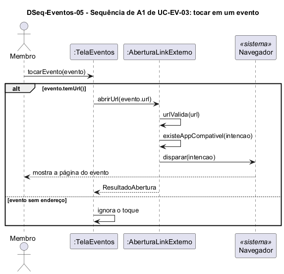

# DSeq-Eventos-05 – Sequência de A1 de UC-EV-03: tocar em um evento

| Campo | Valor |
|---|---|
| **Código** | `DSeq-Eventos-05` |
| **Título** | Sequência de A1 de UC-EV-03: tocar em um evento |
| **Autor(a)** | José Eduardo Gontijo de Carvalho (Pessoa C) |
| **Revisor(a)** | Phablo Tavares Paixão (Pessoa D) |
| **Status** | Em produção (primeira versão) |
| **Rastreia para** | `DAtv-Eventos-03`, `DCla-Eventos-01`, `DCla-Eventos-02`, `DCla-Comum-01`, `DEst-Eventos-01` |

## Diagrama

Fonte: [`DSeq-Eventos-05.puml`](DSeq-Eventos-05.puml)

## Descrição

Detalha a atividade A1 de `DAtv-Eventos-03` (evento E5 do protótipo). A tela consulta `Evento.temUrl()`. Se há endereço, chama `ILinkExterno.abrirUrl(url)`; o componente LinkExterno (`DCla-Comum-01`) valida a URL, procura um app compatível e dispara a abertura no Navegador. A tela não trata o `ResultadoAbertura`, pois o app atual não mostra mensagem de falha. Sem endereço, nada acontece. O estado da tela só muda quando o usuário volta ao app (`aoEntrarNaTela`), situação tratada em `DEst-Eventos-01`.

As premissas `P-EV-n` citadas estão listadas, com o que falta confirmar nas capturas de tela do app, em [`Eventos/README.md`](README.md).

## Referências

INSTITUTE OF ELECTRICAL AND ELECTRONICS ENGINEERS. **Guide to the Software Engineering Body of Knowledge – SWEBOK v4**. Cap. 3 (Software Design). IEEE, 2024.

---

## Registro de revisão

| Data | Revisor(a) | Situação | Observações |
|---|---|---|---|
| | | | |
