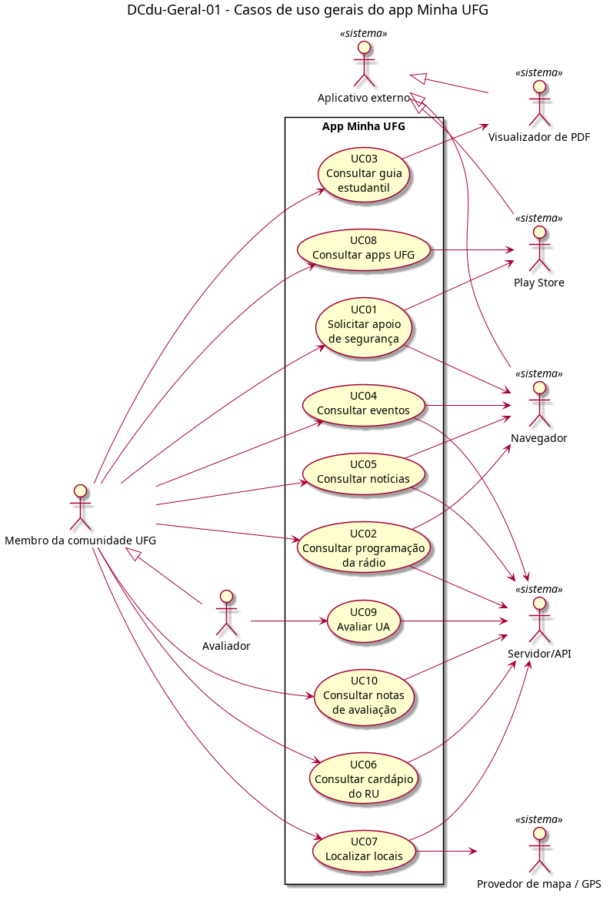

# DCdu-Geral-01 – Casos de uso gerais do app Minha UFG

| Campo | Valor |
|---|---|
| **Código** | `DCdu-Geral-01` |
| **Título** | Casos de uso gerais do app Minha UFG |
| **Autor(a)** | Pessoa D |
| **Revisor(a)** | Pessoa C |
| **Status** | Em revisão |
| **Rastreia para** | `DCdu-Seguranca-01`, `DCdu-Radio-01`, `DCdu-Guia-01`, `DCdu-Eventos-01`, `DCdu-Noticias-01`, `DCdu-RU-01`, `DCdu-Locais-01`, `DCdu-AppsUFG-01`, `DCdu-AvalRegistrar-01`, `DCdu-AvalConsultar-01`, `DImp-Geral-01`, `DPac-Geral-01` |

## Diagrama

Fonte: [`DCdu-Geral-01.puml`](DCdu-Geral-01.puml)

## Descrição

O diagrama apresenta um caso de uso macro por funcionalidade do app: as oito da versão atual (v3.1.1), obtidas por engenharia reversa, e as duas da evolução (Avaliar UA e Consultar notas de avaliação). Cada macro é detalhado pelo dono da funcionalidade no respectivo `DCdu-<Funcionalidade>-01`, com quantos casos de uso forem necessários.

**Atores primários.** O Membro da comunidade UFG usa o app de forma anônima, sem login. O Avaliador é uma especialização do Membro: é o membro que registra uma avaliação de UA, também anônimo. Consultar notas fica com o Membro, pois qualquer usuário pode vê-las.

**Atores secundários.** São sistemas com que o app interage:

| Ator | Papel | Casos de uso |
|---|---|---|
| Servidor/API | Fornece o conteúdo remoto e registra avaliações | Rádio, Eventos, Notícias, RU, Locais, Avaliar UA, Consultar notas |
| Provedor de mapa / GPS | Exibe o mapa do campus e a localização atual | Localizar locais |
| Aplicativo externo (Navegador) | Abre páginas fora do app | Segurança (versão web), Rádio (player), Eventos, Notícias |
| Aplicativo externo (Play Store) | Abre a página de um app na loja | Segurança, Apps UFG |
| Aplicativo externo (Visualizador de PDF) | Abre o guiaestudantil.pdf pelo seletor de apps do Android | Guia estudantil |

O ator abstrato Aplicativo externo agrupa todo redirecionamento para fora do app e corresponde ao componente Abertura de link externo do pacote Comum (`DCmp-Comum-01`).

**Decisões de modelagem.**
- A tela inicial é navegação, não objetivo do usuário; por isso não é caso de uso. Ela é modelada em `DIhc-Inicio-01` e `DEst-Inicio-01`.
- O Painel web não interage com o app: ele alimenta o Servidor/API (cardápio, eventos, notícias, programação, dimensões e questões da avaliação). Por isso aparece só em `DImp-Geral-01`.
- Apps UFG não acessa o Servidor/API, pois a lista é fixa (três apps).

**Correspondência com os DCdu detalhados.** Cada caso de uso detalhado tem o código `UCnn.m`, em que `nn` é o macro deste diagrama (versão final fechada na integração, D-INT-03, em 02/11/2026). O nome do macro resume os casos detalhados e não precisa repeti-los.

| Macro | DCdu detalhado | Casos de uso detalhados |
|---|---|---|
| UC01 Solicitar apoio de segurança | `DCdu-Seguranca-01` | UC01.1 Acessar central de segurança via web; UC01.2 Baixar aplicativo de segurança na Play Store |
| UC02 Consultar programação da rádio | `DCdu-Radio-01` | UC02.1 Consultar programação da rádio; UC02.2 Trocar o dia da programação; UC02.3 Ouvir a rádio |
| UC03 Consultar guia estudantil | `DCdu-Guia-01` | UC03.1 Consultar guia estudantil |
| UC04 Consultar eventos | `DCdu-Eventos-01` | UC04.1 Consultar eventos por regional e data; UC04.2 Trocar o mês do calendário; UC04.3 Abrir a página do evento |
| UC05 Consultar notícias | `DCdu-Noticias-01` | UC05.1 Consultar notícias de uma regional; UC05.2 Abrir a notícia |
| UC06 Consultar cardápio do RU | `DCdu-RU-01` | UC06.1 Consultar o cardápio de uma refeição; UC06.2 Escolher o dia da semana |
| UC07 Localizar locais | `DCdu-Locais-01` | UC07.1 Consultar lista de locais; UC07.2 Visualizar local no mapa; UC07.3 Centralizar em minha localização atual |
| UC08 Consultar apps UFG | `DCdu-AppsUFG-01` | UC08.1 Visualizar catálogo de apps UFG; UC08.2 Abrir aplicativo na Play Store |
| UC09 Avaliar UA | `DCdu-AvalRegistrar-01` | UC09.1 Escolher a unidade acadêmica a avaliar; UC09.2 Responder o questionário de qualidade; UC09.3 Enviar a avaliação; UC09.4 Validar o preenchimento |
| UC10 Consultar notas de avaliação | `DCdu-AvalConsultar-01` | UC10.1 Consultar a nota da UFG e as médias por área CNPq; UC10.2 Consultar as notas das UAs de uma área; UC10.3 Consultar as notas de uma UA por dimensão |

Os atores e as ligações com os atores secundários são os mesmos nos DCdu detalhados.

## Referências

INSTITUTE OF ELECTRICAL AND ELECTRONICS ENGINEERS. **Guide to the Software Engineering Body of Knowledge – SWEBOK v4**. Cap. 11 (Software Engineering Models and Methods). IEEE, 2024.

ANTHROPIC. **Claude**. Assistente de IA. Disponível em: claude.ai. Acesso em: 14 out. 2026. Questão: Apêndice <X>, Seção <X.1>.

---

## Registro de revisão

| Data | Revisor(a) | Situação | Observações |
|---|---|---|---|
| | | | |
