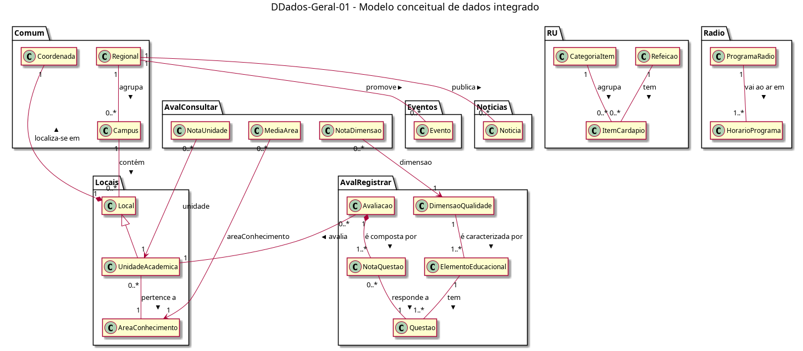

# DDados-Geral-01 – Modelo conceitual de dados integrado

| Campo | Valor |
|---|---|
| **Código** | `DDados-Geral-01` |
| **Título** | Modelo conceitual de dados integrado |
| **Autor(a)** | Pessoa D |
| **Revisor(a)** | Pessoa C |
| **Status** | Em produção |
| **Rastreia para** | `DD-Geral-01`, `DD-Eventos-01`, `DD-Noticias-01`, `DD-RU-01`, `DD-Radio-01`, `DD-Locais-01`, `DD-AvalRegistrar-01`, `DD-AvalConsultar-01`, `DD-Guia-01`, `DD-Seguranca-01`, `DD-AppsUFG-01`, `DPac-Geral-01` |

## Diagrama

Fonte: [`DDados-Geral-01.puml`](DDados-Geral-01.puml)

## Descrição

Esquema conceitual de dados do app Minha UFG com a evolução de Avaliação de UA, montado a partir das entradas de DD de cada pacote, depois da validação (D-INT-01) e da correção dos achados (D-INT-08) registradas em `Integracao/recebimento.md`. Conforme o Apêndice D da APS, o diagrama tem só classes e associações, sem atributos e sem operações; os atributos, os tipos e as enumerações (`TipoRefeicao`, `DiaSemana`) estão no `DD-Geral-01`.

As classes estão agrupadas pelo pacote do dono (contrato-base, seção 7):

- **Comum:** `Regional` e `Campus` (dono: Pessoa C) e `Coordenada` (dono: Pessoa D).
- **Eventos**, **Noticias** e **RU:** Pessoa C.
- **Radio:** Pessoa D.
- **Locais:** `Local`, `UnidadeAcademica` e `AreaConhecimento` (dono: Pessoa B). `UnidadeAcademica` é especialização de `Local`.
- **AvalRegistrar:** Pessoa C. Não há entidade de avaliador: a avaliação é anônima.
- **AvalConsultar:** Pessoa D. `MediaArea`, `NotaUnidade` e `NotaDimensao` são derivadas, calculadas pelo Servidor/API a cada consulta e não armazenadas (`DD-AvalConsultar-01`); as associações são navegáveis só a partir delas.

Guia, Segurança e Apps UFG não têm entidade de domínio (`DD-Guia-01`, `DD-Seguranca-01`, `DD-AppsUFG-01`): o que usam é configuração fixa no app.

Associações entre pacotes, todas conferidas na integração: `Regional`–`Evento`, `Regional`–`Noticia`, `Campus`–`Local`, `Avaliacao`–`UnidadeAcademica`, `NotaUnidade`–`UnidadeAcademica`, `MediaArea`–`AreaConhecimento` e `NotaDimensao`–`DimensaoQualidade`. Cada entidade aparece uma única vez; nenhuma é redefinida em outro pacote.

## Referências

UNIVERSIDADE FEDERAL DE GOIÁS. Instituto de Informática. **Definição de Atividades Práticas Supervisionadas (APS) da Disciplina**: INF 0290 – Projeto de Software, 2026/2. Goiânia, 2026. Apêndice D.

ANTHROPIC. **Claude Code**. Assistente de IA. Disponível em: https://claude.com/claude-code. Acesso em: 2 nov. 2026.

---

## Registro de revisão

| Data | Revisor(a) | Situação | Observações |
|---|---|---|---|
| | | | |
