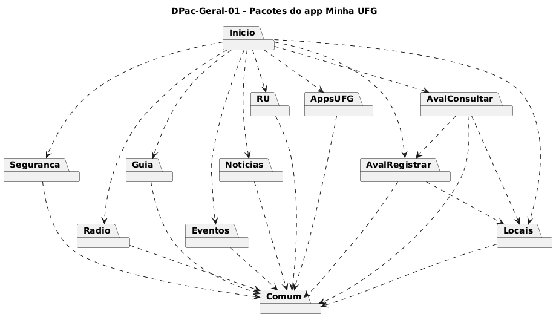

# DPac-Geral-01 – Pacotes do app Minha UFG

| Campo | Valor |
|---|---|
| **Código** | `DPac-Geral-01` |
| **Título** | Pacotes do app Minha UFG |
| **Autor(a)** | Pessoa D |
| **Revisor(a)** | Pessoa C |
| **Status** | Em revisão |
| **Rastreia para** | `DCdu-Geral-01`, `DImp-Geral-01`, `DCmp-Comum-01`, `DCmp-Seguranca-01`, `DCmp-Radio-01`, `DCmp-Guia-01`, `DCmp-Eventos-01`, `DCmp-Noticias-01`, `DCmp-RU-01`, `DCmp-Locais-01`, `DCmp-AppsUFG-01`, `DCmp-AvalRegistrar-01`, `DCmp-AvalConsultar-01`, `DIhc-Inicio-01` |

## Diagrama

Fonte: [`DPac-Geral-01.puml`](DPac-Geral-01.puml)

## Descrição

O app é organizado em um pacote por funcionalidade, um pacote `Inicio` e um pacote `Comum` (contrato-base.md, seção 9). Cada pacote de funcionalidade é detalhado pelo seu dono em `DCmp-<Funcionalidade>-01`.

| Pacote | Conteúdo | Dono |
|---|---|---|
| `Inicio` | Tela inicial: menu de cartões e versão do app | D |
| `Seguranca`, `AvalRegistrar` | Funcionalidades da fatia A | A |
| `Locais`, `AppsUFG`, `AvalConsultar` | Funcionalidades da fatia B | B |
| `Eventos`, `RU`, `Noticias` | Funcionalidades da fatia C | C |
| `Radio`, `Guia` | Funcionalidades da fatia D | D |
| `Comum` | Componentes compartilhados (`DCmp-Comum-01`) | D |

**Dependências.**

- `Inicio` depende de todos os pacotes de funcionalidade, pois cada cartão do menu abre a tela inicial de uma funcionalidade. As oito funcionalidades da versão 3.1.1 têm um cartão cada; a evolução acrescenta um nono cartão, "Avaliação de UA", ponto de entrada único de `AvalRegistrar` e `AvalConsultar` (`DIhc-Inicio-01`).
- Todo pacote de funcionalidade depende de `Comum`, pois usa ao menos um dos seus componentes (acesso à API, estados de tela remota, abertura de link externo ou provedor de mapa).
- `AvalRegistrar` depende de `Locais`, porque a avaliação é feita sobre uma Unidade Acadêmica, entidade definida por B (contrato, seção 7).
- `AvalConsultar` depende de `Locais` (Unidade Acadêmica e Área de conhecimento) e de `AvalRegistrar` (Avaliação, Dimensão de qualidade e Elemento educacional, cujas notas ele agrega).

**Decisões de arquitetura.**

1. *A tela inicial fica num pacote `Inicio` próprio, não em `Comum`.* `Inicio` depende de todas as funcionalidades, enquanto `Comum` é dependido por elas. Juntá-los criaria dependência circular entre `Comum` e cada funcionalidade.
2. *`Comum` não depende de nenhum outro pacote do app.* Isso o mantém reutilizável e estável: mudanças nas funcionalidades nunca o afetam.
3. *Não há dependência entre pacotes de funcionalidades atuais.* Cada funcionalidade da versão 3.1.1 é independente; só a evolução (avaliação) depende de `Locais`.
4. *Pendente para a integração (D-INT-03):* a localização das entidades Regional e Campus, de dono C, usadas por `Eventos`, `Noticias` e `Locais`. Novas dependências entre pacotes reveladas pelos DCmp de A, B e C também serão incorporadas nessa etapa.

## Referências

INSTITUTE OF ELECTRICAL AND ELECTRONICS ENGINEERS. **Guide to the Software Engineering Body of Knowledge – SWEBOK v4**. Cap. 3 (Software Design). IEEE, 2024.

INTERNATIONAL ORGANIZATION FOR STANDARDIZATION; INTERNATIONAL ELECTROTECHNICAL COMMISSION; INSTITUTE OF ELECTRICAL AND ELECTRONICS ENGINEERS. **ISO/IEC/IEEE 12207:2026**: Systems and software engineering – Software life cycle processes. Cláusula 6.4.5 (Design Definition Process). 2026.

ANTHROPIC. **Claude**. Assistente de IA. Disponível em: claude.ai. Acesso em: 14 out. 2026. Questão: Apêndice <X>, Seção <X.1>.

---

## Registro de revisão

| Data | Revisor(a) | Situação | Observações |
|---|---|---|---|
| | | | |
