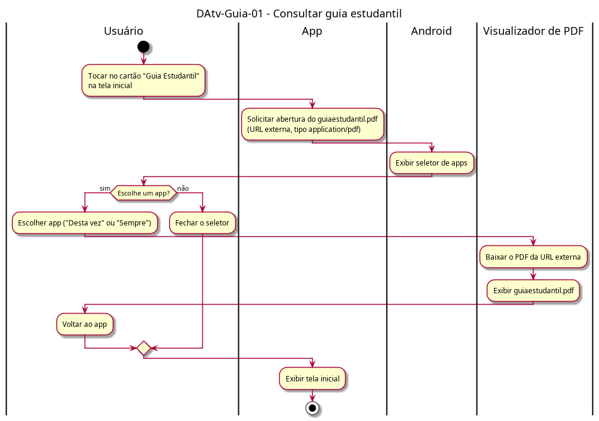

# DAtv-Guia-01 – Consultar guia estudantil

| Campo | Valor |
|---|---|
| **Código** | `DAtv-Guia-01` |
| **Título** | Consultar guia estudantil |
| **Autor(a)** | Pessoa D |
| **Revisor(a)** | Pessoa C |
| **Status** | Em produção |
| **Rastreia para** | `DCdu-Guia-01`, `DIhc-Guia-01`, `DCla-Comum-01` |

## Diagrama

Fonte: [`DAtv-Guia-01.puml`](DAtv-Guia-01.puml)

## Descrição

Atividades do UC03 do `DCdu-Guia-01`, em quatro raias: Usuário, App, Android (seletor de apps) e Visualizador de PDF.

O app só solicita a abertura: passa a URL externa do `guiaestudantil.pdf` e o tipo `application/pdf` ao componente LinkExterno do Comum (`ILinkExterno.abrirDocumento`, `DCla-Comum-01`). Quem baixa e exibe o PDF é o app escolhido. Falhas de download ou de abertura não retornam ao app; por isso o diagrama não tem ramo de erro.

Ações de interação que geram DSeq no D-IND-03:

| Ação | Interação | Evento no `DIhc-Guia-01` |
|---|---|---|
| Tocar no cartão / solicitar abertura do PDF | Usuário → app → Android | E1 |
| Escolher app ou fechar o seletor, e voltar ao app | Usuário → Android → app | E2, E3 |

"Baixar o PDF" e "Exibir guiaestudantil.pdf" acontecem fora do app e não geram DSeq.

## Referências

ANTHROPIC. **Claude Code**. Assistente de IA. Disponível em: https://claude.com/claude-code. Acesso em: 20 out. 2026.

---

## Registro de revisão

| Data | Revisor(a) | Situação | Observações |
|---|---|---|---|
| | | | |
