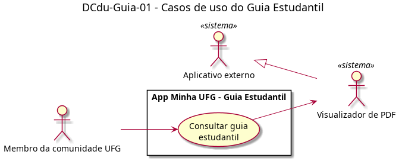

# DCdu-Guia-01 – Casos de uso do Guia Estudantil

| Campo | Valor |
|---|---|
| **Código** | `DCdu-Guia-01` |
| **Título** | Casos de uso do Guia Estudantil |
| **Autor(a)** | Pessoa D |
| **Revisor(a)** | Pessoa C |
| **Status** | Em produção |
| **Rastreia para** | `DCdu-Geral-01`, `DAtv-Guia-01`, `DIhc-Guia-01`, `DCla-Comum-01` |

## Diagrama

Fonte: [`DCdu-Guia-01.puml`](DCdu-Guia-01.puml)

## Descrição

Detalha o caso de uso UC03 "Consultar guia estudantil" do `DCdu-Geral-01`. O Guia não tem tela própria: o cartão da tela inicial entrega o arquivo `guiaestudantil.pdf`, hospedado numa URL externa, a um app do aparelho escolhido pelo seletor de apps do Android. O ator secundário é o **Visualizador de PDF**, especialização de **Aplicativo externo**.

**UC03 – Consultar guia estudantil**

- **Ator principal:** Membro da comunidade UFG (uso anônimo, sem login).
- **Ator secundário:** Visualizador de PDF.
- **Pré-condição:** o usuário está na tela inicial.
- **Fluxo principal:**
  1. O usuário toca no cartão "Guia Estudantil".
  2. O app solicita a abertura do documento pela URL externa, com tipo `application/pdf` (`ILinkExterno.abrirDocumento`, `DCla-Comum-01`).
  3. O Android exibe o seletor de apps.
  4. O usuário escolhe um app ("Desta vez" ou "Sempre").
  5. O app escolhido baixa e exibe o PDF.
  6. O usuário volta ao app, que exibe a tela inicial.
- **Fluxo alternativo A1 (seletor fechado):** no passo 4, o usuário fecha o seletor; o app continua na tela inicial.
- **Pós-condição:** o app permanece na tela inicial.

Fora do escopo do app: download, exibição e falhas de abertura do PDF são tratados pelo app externo ou pelo próprio Android (ex.: mensagem de formato incompatível). Esses erros não retornam ao app.

## Referências

ANTHROPIC. **Claude Code**. Assistente de IA. Disponível em: https://claude.com/claude-code. Acesso em: 20 out. 2026.

---

## Registro de revisão

| Data | Revisor(a) | Situação | Observações |
|---|---|---|---|
| | | | |
