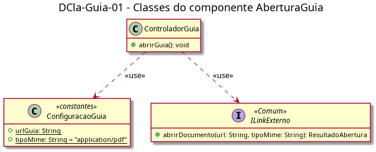

# DCla-Guia-01 – Classes do componente AberturaGuia

| Campo | Valor |
|---|---|
| **Código** | `DCla-Guia-01` |
| **Título** | Classes do componente AberturaGuia |
| **Autor(a)** | Pessoa D |
| **Revisor(a)** | Pessoa C |
| **Status** | Em produção |
| **Rastreia para** | `DCmp-Guia-01`, `DCla-Comum-01`, `DD-Guia-01`, `DAtv-Guia-01` |

## Diagrama

Fonte: [`DCla-Guia-01.puml`](DCla-Guia-01.puml)

## Descrição

- **ControladorGuia:** trata o toque no cartão (evento E1 do `DIhc-Guia-01`). `abrirGuia()` lê a configuração e chama `ILinkExterno.abrirDocumento(urlGuia, tipoMime)`. O `ResultadoAbertura` retornado é ignorado: falhas de abertura são tratadas pelo Android e não retornam ao app (`DCdu-Guia-01`).
- **ConfiguracaoGuia:** constantes do Guia. `urlGuia` é a URL externa do `guiaestudantil.pdf`; `tipoMime` é `application/pdf`. Não é entidade (ver `DD-Guia-01`).
- **ILinkExterno:** interface do pacote Comum, só referenciada aqui; definida no `DCla-Comum-01`.

## Referências

ANTHROPIC. **Claude Code**. Assistente de IA. Disponível em: https://claude.com/claude-code. Acesso em: 20 out. 2026.

---

## Registro de revisão

| Data | Revisor(a) | Situação | Observações |
|---|---|---|---|
| | | | |
