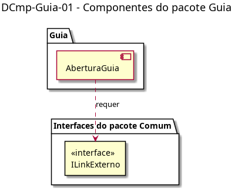

# DCmp-Guia-01 – Componentes do pacote Guia

| Campo | Valor |
|---|---|
| **Código** | `DCmp-Guia-01` |
| **Título** | Componentes do pacote Guia |
| **Autor(a)** | Pessoa D |
| **Revisor(a)** | Pessoa C |
| **Status** | Em produção |
| **Rastreia para** | `DPac-Geral-01`, `DCmp-Comum-01`, `DCla-Guia-01`, `DAtv-Guia-01` |

## Diagrama

Fonte: [`DCmp-Guia-01.puml`](DCmp-Guia-01.puml)

## Descrição

O pacote Guia tem um único componente, **AberturaGuia**, acionado pelo cartão "Guia Estudantil" da tela inicial. Ele requer só a interface `ILinkExterno` do pacote Comum (`DCmp-Comum-01`), que abre o PDF pelo seletor de apps do Android.

O Guia não tem tela remota nem dados do Servidor/API; por isso não depende de `IControladorTelaRemota`, `IFonteDados` nem `IAcessoApi`.

## Referências

ANTHROPIC. **Claude Code**. Assistente de IA. Disponível em: https://claude.com/claude-code. Acesso em: 20 out. 2026.

---

## Registro de revisão

| Data | Revisor(a) | Situação | Observações |
|---|---|---|---|
| | | | |
