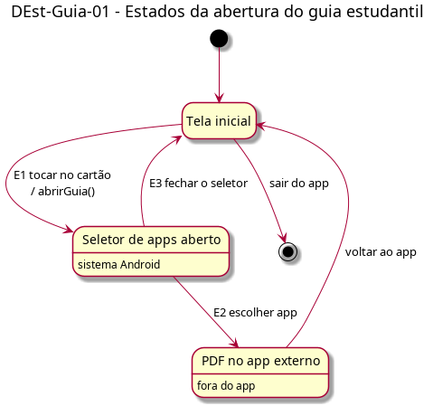

# DEst-Guia-01 – Estados da abertura do guia estudantil

| Campo | Valor |
|---|---|
| **Código** | `DEst-Guia-01` |
| **Título** | Estados da abertura do guia estudantil |
| **Autor(a)** | Pessoa D |
| **Revisor(a)** | Pessoa C |
| **Status** | Em produção |
| **Rastreia para** | `DIhc-Guia-01`, `DSeq-Guia-01`, `DSeq-Guia-02`, `DEst-Inicio-01` |

## Diagrama

Fonte: [`DEst-Guia-01.puml`](DEst-Guia-01.puml)

## Descrição

Estados do `DIhc-Guia-01`, com os eventos E1 a E3 tratados:

| Estado | Significado |
|---|---|
| Tela inicial | O app exibe a tela inicial (`DEst-Inicio-01`, D-IND-07) |
| Seletor de apps aberto | O seletor do Android está sobre a tela inicial |
| PDF no app externo | O guia está aberto no app escolhido, fora do app |

O Guia não usa os estados de tela remota do Comum (`DEst-Comum-01`): não há carregamento, estado vazio nem indisponível.

## Referências

ANTHROPIC. **Claude Code**. Assistente de IA. Disponível em: https://claude.com/claude-code. Acesso em: 20 out. 2026.

---

## Registro de revisão

| Data | Revisor(a) | Situação | Observações |
|---|---|---|---|
| | | | |
