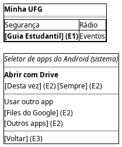

# DIhc-Guia-01 – Abertura do guia estudantil pelo seletor de apps

| Campo | Valor |
|---|---|
| **Código** | `DIhc-Guia-01` |
| **Título** | Abertura do guia estudantil pelo seletor de apps |
| **Autor(a)** | Pessoa D |
| **Revisor(a)** | Pessoa C |
| **Status** | Em produção |
| **Rastreia para** | `DCdu-Guia-01`, `DAtv-Guia-01`, `DIhc-Inicio-01`, `DEst-Guia-01` |

## Diagrama

Fonte: [`DIhc-Guia-01.puml`](DIhc-Guia-01.puml)

## Descrição

O Guia não tem tela própria no app. O protótipo mostra o ponto de entrada (trecho da tela inicial, com o cartão "Guia Estudantil" em destaque) e o seletor de apps do Android, que se sobrepõe à tela inicial. O seletor é do sistema, não do app; aparece aqui só para documentar os eventos que o app recebe de volta. A tela inicial completa é modelada no `DIhc-Inicio-01` (D-IND-07).

Eventos de interação, tratados no `DEst-Guia-01`:

| Evento | Origem | Efeito |
|---|---|---|
| E1 | Tocar no cartão "Guia Estudantil" | O app solicita a abertura do PDF; o Android exibe o seletor |
| E2 | Escolher um app ("Desta vez", "Sempre" ou outro app da lista) | O app escolhido baixa e exibe o PDF; ao voltar, o app mostra a tela inicial |
| E3 | Fechar o seletor (voltar ou tocar fora) | O app continua na tela inicial |

A lista de apps do seletor varia conforme o aparelho; o protótipo segue o print da versão 3.1.1 (Drive como sugestão, Files do Google na lista).

## Referências

ANTHROPIC. **Claude Code**. Assistente de IA. Disponível em: https://claude.com/claude-code. Acesso em: 20 out. 2026.

---

## Registro de revisão

| Data | Revisor(a) | Situação | Observações |
|---|---|---|---|
| | | | |
