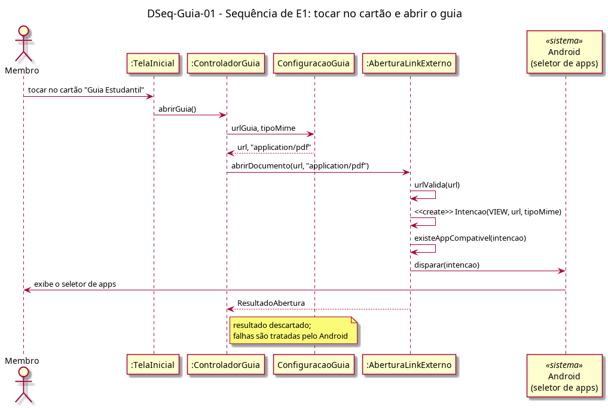

# DSeq-Guia-01 – Sequência de E1: tocar no cartão e abrir o guia

| Campo | Valor |
|---|---|
| **Código** | `DSeq-Guia-01` |
| **Título** | Sequência de E1: tocar no cartão e abrir o guia |
| **Autor(a)** | Pessoa D |
| **Revisor(a)** | Pessoa C |
| **Status** | Em produção |
| **Rastreia para** | `DAtv-Guia-01`, `DIhc-Guia-01`, `DCla-Guia-01`, `DCla-Comum-01`, `Contrato-Guia-01`, `DIhc-Inicio-01` |

## Diagrama

Fonte: [`DSeq-Guia-01.puml`](DSeq-Guia-01.puml)

## Descrição

Detalha a ação "tocar no cartão / solicitar abertura do PDF" do `DAtv-Guia-01` (evento E1 do `DIhc-Guia-01`). A tela inicial (`DIhc-Inicio-01`, D-IND-07) repassa o toque ao `ControladorGuia`, que lê a URL e o tipo da `ConfiguracaoGuia` e chama `abrirDocumento` do componente LinkExterno (`DCla-Comum-01`). O LinkExterno valida a URL, monta a `Intencao` e a dispara; o Android exibe o seletor de apps.

O `ResultadoAbertura` é descartado: falhas de abertura são mostradas pelo próprio Android e não retornam ao app. Não há chamada ao Servidor/API.

## Referências

ANTHROPIC. **Claude Code**. Assistente de IA. Disponível em: https://claude.com/claude-code. Acesso em: 20 out. 2026.

---

## Registro de revisão

| Data | Revisor(a) | Situação | Observações |
|---|---|---|---|
| | | | |
