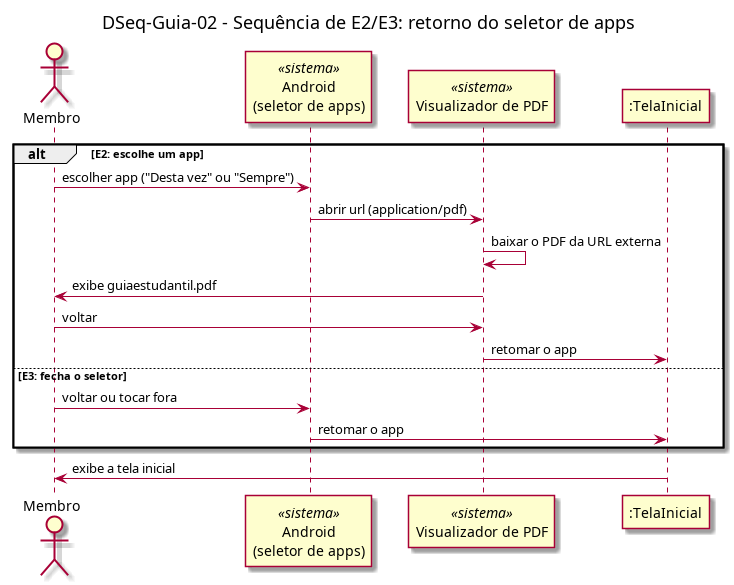

# DSeq-Guia-02 – Sequência de E2/E3: retorno do seletor de apps

| Campo | Valor |
|---|---|
| **Código** | `DSeq-Guia-02` |
| **Título** | Sequência de E2/E3: retorno do seletor de apps |
| **Autor(a)** | Pessoa D |
| **Revisor(a)** | Pessoa C |
| **Status** | Em produção |
| **Rastreia para** | `DAtv-Guia-01`, `DIhc-Guia-01`, `DEst-Guia-01`, `DCdu-Guia-01` |

## Diagrama

Fonte: [`DSeq-Guia-02.puml`](DSeq-Guia-02.puml)

## Descrição

Detalha a ação "escolher app ou fechar o seletor, e voltar ao app" do `DAtv-Guia-01` (eventos E2 e E3 do `DIhc-Guia-01`).

- **E2:** o usuário escolhe um app; o Visualizador de PDF baixa o arquivo da URL externa e o exibe. Ao voltar, o Android retoma o app na tela inicial.
- **E3:** o usuário fecha o seletor; o Android retoma o app na tela inicial.

Nenhum objeto do pacote Guia participa do retorno: o app não recebe resposta do seletor nem do app externo, apenas volta a exibir a tela inicial.

## Referências

ANTHROPIC. **Claude Code**. Assistente de IA. Disponível em: https://claude.com/claude-code. Acesso em: 20 out. 2026.

---

## Registro de revisão

| Data | Revisor(a) | Situação | Observações |
|---|---|---|---|
| | | | |
