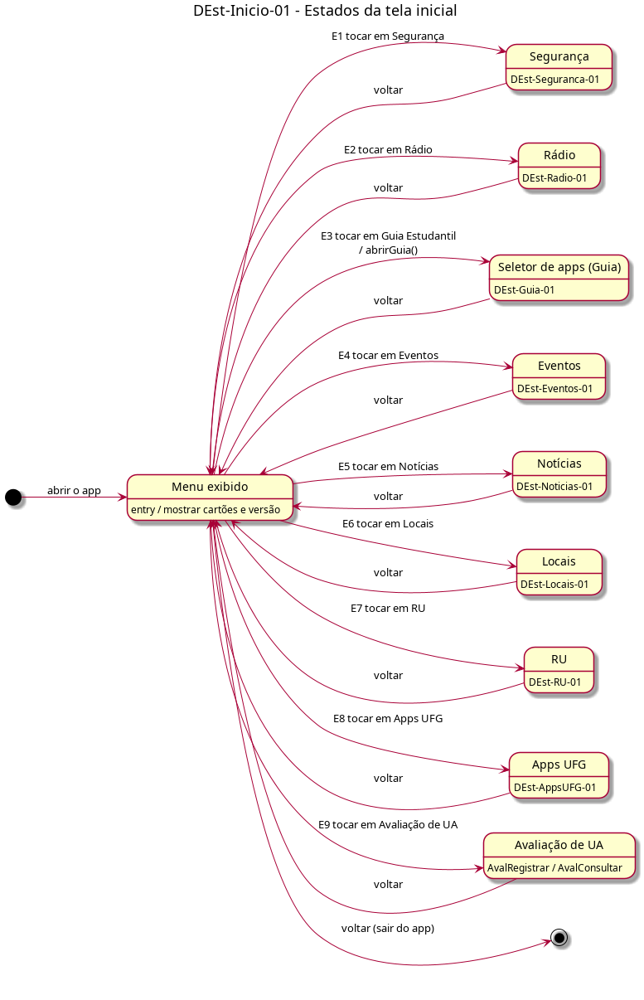

# DEst-Inicio-01 – Estados da tela inicial

| Campo | Valor |
|---|---|
| **Código** | `DEst-Inicio-01` |
| **Título** | Estados da tela inicial |
| **Autor(a)** | Pessoa D |
| **Revisor(a)** | Pessoa C |
| **Status** | Em produção |
| **Rastreia para** | `DIhc-Inicio-01`, `DEst-Guia-01`, `DEst-Radio-01`, `DEst-Eventos-01`, `DPac-Geral-01` |

## Diagrama

Fonte: [`DEst-Inicio-01.puml`](DEst-Inicio-01.puml)

## Descrição

A tela inicial tem um só estado próprio, **Menu exibido**. Cada cartão do `DIhc-Inicio-01` (E1 a E9) gera uma transição para o estado inicial da funcionalidade correspondente, detalhado no DEst do seu dono; ao voltar, o menu é exibido de novo. Voltar a partir do menu encerra o app.

O Guia é a exceção: não abre tela própria, e sim o seletor de apps do Android (`DEst-Guia-01`), com a ação `abrirGuia()`.

Os DEst referenciados que ainda não existem (Segurança, Notícias, Locais, RU, Apps UFG e Avaliação de UA) são de A, B e C e serão conferidos na integração (D-INT-03).

## Referências

ANTHROPIC. **Claude Code**. Assistente de IA. Disponível em: https://claude.com/claude-code. Acesso em: 20 out. 2026.

---

## Registro de revisão

| Data | Revisor(a) | Situação | Observações |
|---|---|---|---|
| | | | |
