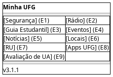

# DIhc-Inicio-01 – Tela inicial

| Campo | Valor |
|---|---|
| **Código** | `DIhc-Inicio-01` |
| **Título** | Tela inicial |
| **Autor(a)** | Pessoa D |
| **Revisor(a)** | Pessoa C |
| **Status** | Em produção |
| **Rastreia para** | `DCdu-Geral-01`, `DPac-Geral-01`, `DEst-Inicio-01`, `DIhc-Guia-01`, `DIhc-Radio-01`, `DIhc-Eventos-01` |

## Diagrama

Fonte: [`DIhc-Inicio-01.puml`](DIhc-Inicio-01.puml)

## Descrição

Protótipo da tela inicial, conforme o print da versão 3.1.1: logotipo "Minha UFG", grade de cartões em duas colunas (cada um com ícone e rótulo) e a versão do app no rodapé. A versão é só texto fixo, sem ação.

Os oito primeiros cartões são os da versão 3.1.1. O nono, **"Avaliação de UA"**, é a evolução: ponto de entrada único de `AvalRegistrar` e `AvalConsultar`. A tela que ele abre é definida pelas Pessoas A e B.

| Evento | Cartão | Abre |
|---|---|---|
| E1 | Segurança | Tela de Segurança |
| E2 | Rádio | Tela da Rádio (`DIhc-Radio-01`) |
| E3 | Guia Estudantil | Seletor de apps com o guia em PDF (`DIhc-Guia-01`) |
| E4 | Eventos | Tela de Eventos (`DIhc-Eventos-01`) |
| E5 | Notícias | Tela de Notícias |
| E6 | Locais | Tela de Locais |
| E7 | RU | Tela do RU |
| E8 | Apps UFG | Tela de Apps UFG |
| E9 | Avaliação de UA | Entrada da avaliação de UA (evolução) |

A tela não tem conteúdo remoto: não usa os estados de tela remota do Comum.

## Referências

ANTHROPIC. **Claude Code**. Assistente de IA. Disponível em: https://claude.com/claude-code. Acesso em: 20 out. 2026.

---

## Registro de revisão

| Data | Revisor(a) | Situação | Observações |
|---|---|---|---|
| | | | |
