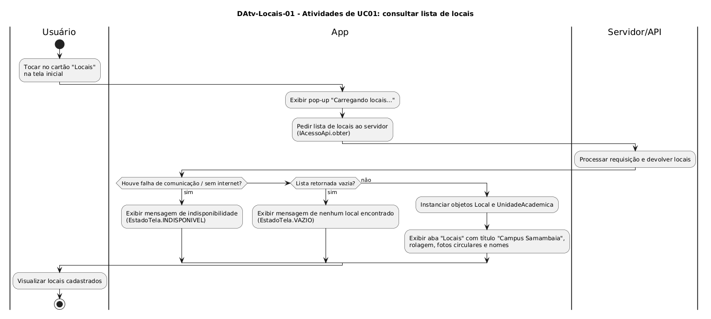

# DAtv-Locais-01 – Atividades de UC01: consultar lista de locais

| Campo | Valor |
|---|---|
| **Código** | `DAtv-Locais-01` |
| **Título** | Atividades de UC01: consultar lista de locais |
| **Autor(a)** | Maicon Brendo da Silva |
| **Revisor(a)** | Revisor(a) a definir |
| **Status** | Em produção |
| **Rastreia para** | `DCdu-Locais-01`, `DIhc-Locais-01`, `DCla-Comum-02`, `DCla-Comum-03`, `DSeq-Locais-01` |

## Diagrama

Fonte: [`DAtv-Locais-01.puml`](DAtv-Locais-01.puml)

## Descrição

O diagrama detalha o fluxo de atividades do caso de uso `UC01: Consultar lista de locais`, organizando as responsabilidades em três raias: **Usuário**, **App** e **Servidor/API**.

### Dinâmica das atividades

1. O usuário aciona o cartão "Locais" na tela inicial do Minha UFG.
2. O aplicativo entra em estado transitório de carregamento (`CARREGANDO`), exibindo ao usuário o pop-up nativo *"Carregando locais..."*.
3. O app solicita a lista remota de locais via interface de comunicação de rede `IAcessoApi.obter("/locais")` do pacote `Comum`.
4. O servidor remoto processa a requisição e devolve o conjunto de dados.
5. Caso ocorra falha de rede ou timeout, o app transiciona para o estado `INDISPONIVEL`.
6. Caso a lista retorne vazia, o app transiciona para o estado `VAZIO`.
7. Havendo sucesso, o app instancia os objetos de domínio (`Local` e `UnidadeAcademica`), finaliza o pop-up de carregamento e apresenta a tela da aba "Locais" com título "Campus Samambaia", fotos circulares em miniatura e nomes dos pontos de interesse.

### Ações de interação e granularidade de sequência

A carga de dados remotos assíncrona entre o app e o servidor gera o diagrama de sequência correspondente:

| Ação no DAtv | Natureza da interação | Item gerado |
|---|---|---|
| Requisitar locais ao servidor | App $\rightarrow$ `IAcessoApi` $\rightarrow$ Servidor/API | `DSeq-Locais-01` |

## Referências

GOOGLE. **Antigravity**. Assistente de IA para Engenharia de Software. Disponível em: https://antigravity.google.com. Acesso em: 30 out. 2026.

INSTITUTE OF ELECTRICAL AND ELECTRONICS ENGINEERS. **Guide to the Software Engineering Body of Knowledge – SWEBOK v4**. Cap. 11 (Software Engineering Models and Methods). IEEE, 2024.

---

## Registro de revisão

| Data | Revisor(a) | Situação | Observações |
|---|---|---|---|
| | | | |

