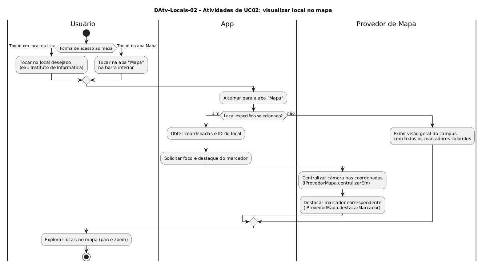

# DAtv-Locais-02 – Atividades de UC02: visualizar local no mapa

| Campo | Valor |
|---|---|
| **Código** | `DAtv-Locais-02` |
| **Título** | Atividades de UC02: visualizar local no mapa |
| **Autor(a)** | Maicon Brendo da Silva |
| **Revisor(a)** | Revisor(a) a definir |
| **Status** | Em produção |
| **Rastreia para** | `DCdu-Locais-01`, `DIhc-Locais-01`, `DIhc-Locais-02`, `DCla-Comum-04`, `DSeq-Locais-02` |

## Diagrama

Fonte: [`DAtv-Locais-02.puml`](DAtv-Locais-02.puml)

## Descrição

O diagrama detalha o fluxo de atividades do caso de uso `UC02: Visualizar local no mapa`, modelando a interação visual entre a aba de lista e a aba cartográfica através de três raias: **Usuário**, **App** e **Provedor de Mapa**.

### Dinâmica das atividades

O usuário pode acessar a visualização geográfica por dois caminhos distintos:
1. **Seleção a partir da lista:** Ao tocar em um ponto específico da lista de locais (por exemplo, "Instituto de Informática"), o app captura a coordenada e o identificador do local, transiciona automaticamente a interface para a aba "Mapa", desloca a câmera para o ponto desejado (`IProvedorMapa.centralizarEm`) e ativa o destaque gráfico do marcador (`IProvedorMapa.destacarMarcador`).
2. **Acesso direto pela barra inferior:** Ao tocar diretamente na aba "Mapa", o app exibe a visão panorâmica do Campus Samambaia com todos os marcadores coloridos renderizados em suas respectivas posições.

### Ações de interação e granularidade de sequência

A transição com foco em um ponto específico do mapa gera o diagrama de sequência correspondente:

| Ação no DAtv | Natureza da interação | Item gerado |
|---|---|---|
| Tocar em local da lista e focar no mapa | Usuário $\rightarrow$ App $\rightarrow$ `IProvedorMapa` | `DSeq-Locais-02` |

## Referências

GOOGLE. **Antigravity**. Assistente de IA para Engenharia de Software. Disponível em: https://antigravity.google.com. Acesso em: 30 out. 2026.

INSTITUTE OF ELECTRICAL AND ELECTRONICS ENGINEERS. **Guide to the Software Engineering Body of Knowledge – SWEBOK v4**. Cap. 11 (Software Engineering Models and Methods). IEEE, 2024.

---

## Registro de revisão

| Data | Revisor(a) | Situação | Observações |
|---|---|---|---|
| | | | |

