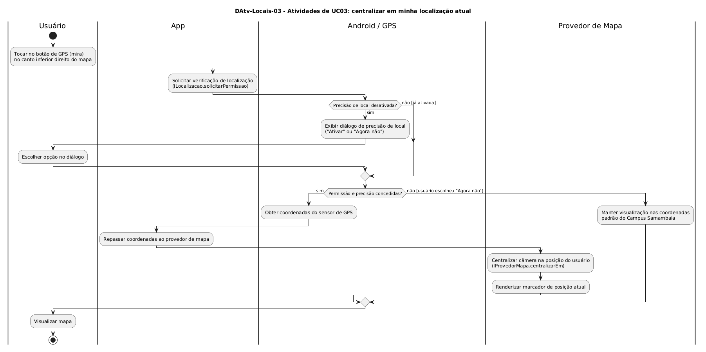

# DAtv-Locais-03 – Atividades de UC03: centralizar em minha localização atual

| Campo | Valor |
|---|---|
| **Código** | `DAtv-Locais-03` |
| **Título** | Atividades de UC03: centralizar em minha localização atual |
| **Autor(a)** | Maicon Brendo da Silva |
| **Revisor(a)** | Revisor(a) a definir |
| **Status** | Em produção |
| **Rastreia para** | `DCdu-Locais-01`, `DIhc-Locais-02`, `DCla-Comum-04`, `DSeq-Locais-03` |

## Diagrama

Fonte: [`DAtv-Locais-03.puml`](DAtv-Locais-03.puml)

## Descrição

O diagrama detalha o fluxo de atividades do caso de uso `UC03: Centralizar em minha localização atual`, modelando a integração do app Minha UFG com os sensores de geolocalização do aparelho móvel e com o provedor de mapa, estruturado em quatro raias: **Usuário**, **App**, **Android / GPS** e **Provedor de Mapa**.

### Dinâmica das atividades

1. O usuário toca no botão flutuante com ícone de mira/GPS no canto inferior direito da tela do mapa.
2. O app aciona o componente de localização através de `ILocalizacao.solicitarPermissao()`.
3. Caso a precisão de local esteja ativa no dispositivo, o app obtém as coordenadas atuais (`ILocalizacao.obterLocalizacaoAtual()`), solicita ao mapa a centralização na posição do usuário (`IProvedorMapa.centralizarEm`) e renderiza o ponto de localização.
4. Caso a precisão esteja desativada no aparelho, o sistema operacional Android exibe o diálogo nativo do Google Play Services *"Para uma experiência melhor, o dispositivo precisa usar a Precisão de Local"*, com as opções *"Ativar"* e *"Agora não"*.
5. Se o usuário confirmar ("Ativar"), o Android ativa o sensor e o mapa é centralizado na posição atual.
6. Se o usuário recusar ("Agora não"), o app não recebe as coordenadas do usuário e preserva o mapa centralizado nas coordenadas padrão do Campus Samambaia com todos os prédios da UFG navegáveis.

### Ações de interação e granularidade de sequência

O acionamento do botão de GPS e o ciclo de obtenção de coordenadas geram o diagrama de sequência:

| Ação no DAtv | Natureza da interação | Item gerado |
|---|---|---|
| Tocar no botão GPS e centralizar posição | Usuário $\rightarrow$ App $\rightarrow$ `ILocalizacao` $\rightarrow$ `IProvedorMapa` | `DSeq-Locais-03` |

## Referências

GOOGLE. **Antigravity**. Assistente de IA para Engenharia de Software. Disponível em: https://antigravity.google.com. Acesso em: 30 out. 2026.

INSTITUTE OF ELECTRICAL AND ELECTRONICS ENGINEERS. **Guide to the Software Engineering Body of Knowledge – SWEBOK v4**. Cap. 11 (Software Engineering Models and Methods). IEEE, 2024.

---

## Registro de revisão

| Data | Revisor(a) | Situação | Observações |
|---|---|---|---|
| | | | |

