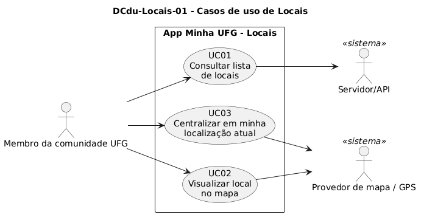

# DCdu-Locais-01 – Casos de uso de Locais

| Campo | Valor |
|---|---|
| **Código** | `DCdu-Locais-01` |
| **Título** | Casos de uso de Locais |
| **Autor(a)** | Maicon Brendo da Silva |
| **Revisor(a)** | Revisor(a) a definir |
| **Status** | Em produção |
| **Rastreia para** | `DCdu-Geral-01`, `DPac-Geral-01`, `DAtv-Locais-01`, `DAtv-Locais-02`, `DAtv-Locais-03`, `DIhc-Locais-01`, `DIhc-Locais-02`, `DCla-Comum-02`, `DCla-Comum-04` |

## Diagrama

Fonte: [`DCdu-Locais-01.puml`](DCdu-Locais-01.puml)

## Descrição

O diagrama detalha o caso de uso macro UC07 "Localizar locais" do `DCdu-Geral-01`. A funcionalidade oferece à comunidade universitária acesso ao catálogo completo de prédios e pontos de interesse do Campus Samambaia (como Unidades Acadêmicas, restaurantes, bibliotecas e serviços), permitindo consultá-los em formato de lista, visualizá-los geograficamente em um mapa interativo com marcadores coloridos por categoria e utilizar o GPS do aparelho para obter a localização em tempo real no campus.

### Atores

- **Membro da comunidade UFG:** Ator primário que utiliza a busca, navegação e mapa de forma anônima e sem exigência de login.
- **Servidor/API:** Ator secundário (especialização de sistema) responsável por fornecer a lista de locais e suas coordenadas geográficas.
- **Provedor de mapa / GPS:** Ator secundário (especialização de sistema) que provê a renderização cartográfica, o posicionamento dos marcadores coloridos e a leitura do sensor de geolocalização do dispositivo móvel.

---

### UC01 – Consultar lista de locais

- **Ator principal:** Membro da comunidade UFG.
- **Ator secundário:** Servidor/API.
- **Pré-condição:** O usuário toca no cartão "Locais" na tela inicial do Minha UFG.
- **Fluxo principal:**
  1. O aplicativo exibe uma mensagem transitória informando o carregamento dos locais ("Carregando locais...").
  2. O app requisita ao Servidor/API a lista de locais do campus através da interface de rede (`IAcessoApi.obter("/locais")`).
  3. O Servidor/API retorna o conjunto de dados com os locais cadastrados (identificador, nome, foto, coordenadas e categoria/cor).
  4. O app exibe a aba "Locais", contendo a lista com fotos circulares e nomes em destaque sob o título "Campus Samambaia".
- **Fluxo alternativo A1 (Falha de comunicação / sem internet):**
  1. No passo 2, caso ocorra falha de rede ou timeout, o app transiciona para o estado `INDISPONIVEL`, apresentando mensagem explicativa na tela.
- **Pós-condição:** A lista de locais do campus permanece exibida na aba "Locais" para consulta e rolagem.

---

### UC02 – Visualizar local no mapa

- **Ator principal:** Membro da comunidade UFG.
- **Ator secundário:** Provedor de mapa / GPS.
- **Pré-condição:** O usuário acessa a funcionalidade de Locais.
- **Fluxo principal:**
  1. O usuário toca em qualquer local na lista de locais (ou toca diretamente na aba "Mapa" na barra inferior).
  2. O aplicativo alterna a aba ativa para "Mapa".
  3. O app solicita ao componente cartográfico (`IProvedorMapa.centralizarEm`) o posicionamento da câmera nas coordenadas geográficas do local selecionado.
  4. O app solicita o destaque visual do marcador do local (`IProvedorMapa.destacarMarcador`), permitindo ao usuário identificar com facilidade o prédio no mapa com seu círculo colorido correspondente.
- **Pós-condição:** O mapa é exibido com o local centralizado e destacado.

---

### UC03 – Centralizar em minha localização atual

- **Ator principal:** Membro da comunidade UFG.
- **Ator secundário:** Provedor de mapa / GPS.
- **Pré-condição:** O usuário está na aba "Mapa".
- **Fluxo principal:**
  1. O usuário toca no botão flutuante com ícone de mira/GPS no canto inferior direito do mapa.
  2. O app verifica a disponibilidade do sensor de localização via `ILocalizacao.solicitarPermissao()`.
  3. Com a precisão ativada, o app invoca `ILocalizacao.obterLocalizacaoAtual()`.
  4. O provedor de GPS retorna as coordenadas geográficas atuais do usuário.
  5. O app solicita a centralização da câmera do mapa na posição do usuário (`IProvedorMapa.centralizarEm(posicaoAtual)`) e renderiza o ponto de localização do dispositivo.
- **Fluxo alternativo A1 (Localização desligada / Usuário recusa ativação):**
  1. No passo 2, caso a localização do dispositivo esteja desligada, o Android exibe o diálogo nativo ("Para uma experiência melhor, o dispositivo precisa usar a Precisão de Local").
  2. O usuário escolhe a opção "Agora não".
  3. O app mantém o mapa centralizado nas coordenadas padrão do Campus Samambaia com todos os marcadores coloridos dos locais da UFG visíveis e navegáveis.
- **Pós-condição:** O mapa é atualizado para a posição do usuário ou permanece na visão geral do campus.

## Referências

GOOGLE. **Antigravity**. Assistente de IA para Engenharia de Software. Disponível em: https://antigravity.google.com. Acesso em: 30 out. 2026.

INSTITUTE OF ELECTRICAL AND ELECTRONICS ENGINEERS. **Guide to the Software Engineering Body of Knowledge – SWEBOK v4**. Cap. 11 (Software Engineering Models and Methods). IEEE, 2024.

---

## Registro de revisão

| Data | Revisor(a) | Situação | Observações |
|---|---|---|---|
| | | | |
