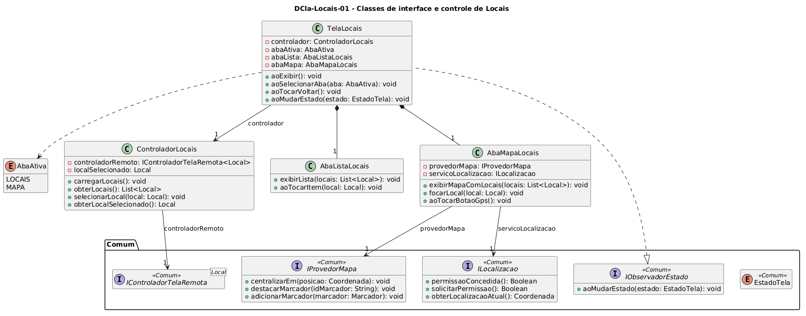

# DCla-Locais-01 – Classes de interface e controle de Locais

| Campo | Valor |
|---|---|
| **Código** | `DCla-Locais-01` |
| **Título** | Classes de interface e controle de Locais |
| **Autor(a)** | Maicon Brendo da Silva |
| **Revisor(a)** | Revisor(a) a definir |
| **Status** | Em produção |
| **Rastreia para** | `DPac-Geral-01`, `DCmp-Locais-01`, `DCla-Comum-03`, `DCla-Comum-04`, `DIhc-Locais-01`, `DIhc-Locais-02`, `DSeq-Locais-01`, `DSeq-Locais-02`, `DSeq-Locais-03` |

## Diagrama

Fonte: [`DCla-Locais-01.puml`](DCla-Locais-01.puml)

## Descrição

O diagrama detalha a arquitetura orientada a objetos da camada de apresentação e controle da funcionalidade Locais, estruturando as responsabilidades de navegação em abas e a integração com os serviços do pacote `Comum`.

### Componentes de Interface e Controle

- **`TelaLocais`:** Classe principal de apresentação que atua como observadora de estado (`IObservadorEstado`), reagindo aos ciclos assíncronos (`CARREGANDO`, `EXIBINDO`, `VAZIO`, `INDISPONIVEL`). Gerencia a alternância entre a visualização de lista e de mapa através da enumeração `AbaAtiva`.
- **`AbaListaLocais`:** Sub-visão responsável pela renderização da lista vertical de prédios com fotos redondas e nomes, capturando o toque do usuário.
- **`AbaMapaLocais`:** Sub-visão responsável pelo controle da área cartográfica e do botão de GPS, interagindo com o provedor de mapas (`IProvedorMapa`) e o serviço de localização (`ILocalizacao`).
- **`ControladorLocais`:** Coordena a lógica da funcionalidade, mediando a carga assíncrona com `IControladorTelaRemota<Local>` e armazenando o local selecionado em memória para foco no mapa.

## Referências

GOOGLE. **Antigravity**. Assistente de IA para Engenharia de Software. Disponível em: https://antigravity.google.com. Acesso em: 30 out. 2026.

INSTITUTE OF ELECTRICAL AND ELECTRONICS ENGINEERS. **Guide to the Software Engineering Body of Knowledge – SWEBOK v4**. Cap. 3 (Software Design). IEEE, 2024.

---

## Registro de revisão

| Data | Revisor(a) | Situação | Observações |
|---|---|---|---|
| | | | |

