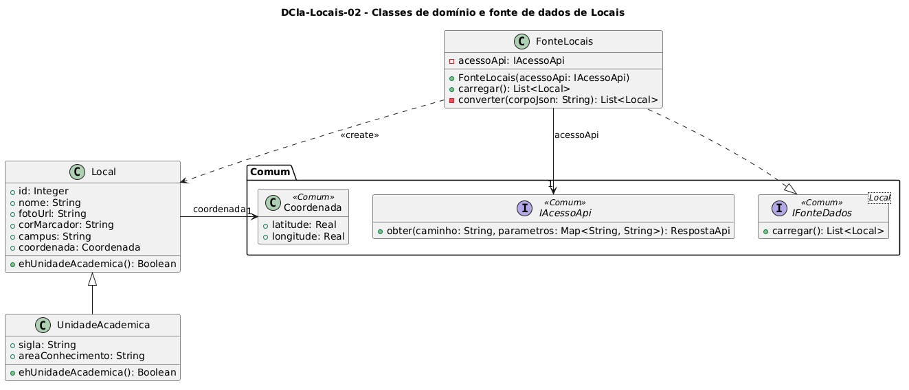

# DCla-Locais-02 – Classes de domínio e fonte de dados de Locais

| Campo | Valor |
|---|---|
| **Código** | `DCla-Locais-02` |
| **Título** | Classes de domínio e fonte de dados de Locais |
| **Autor(a)** | Maicon Brendo da Silva |
| **Revisor(a)** | Revisor(a) a definir |
| **Status** | Em produção |
| **Rastreia para** | `DPac-Geral-01`, `DD-Locais-01`, `DCla-Locais-01`, `DCla-Comum-02`, `DCla-Comum-03`, `DSeq-Locais-01` |

## Diagrama

Fonte: [`DCla-Locais-02.puml`](DCla-Locais-02.puml)

## Descrição

O diagrama modela as entidades do modelo de domínio da funcionalidade Locais e o componente de acesso a dados remotos.

### Camada de Domínio e Fonte de Dados

- **`Local`:** Entidade base do domínio que representa qualquer ponto de interesse ou instalação no Campus Samambaia. Possui identificador, nome, foto circular, cor do marcador no mapa e coordenadas geográficas (`Coordenada` do pacote `Comum`). O método polimórfico `ehUnidadeAcademica()` retorna `false` por padrão.
- **`UnidadeAcademica`:** Subclasse especializada de `Local` que representa unidades acadêmicas da universidade (institutos e faculdades). Adiciona os atributos `sigla` e `areaConhecimento`, sobrescrevendo `ehUnidadeAcademica()` para retornar `true`. Essa classe é compartilhada com o módulo de avaliação institucional, conforme seção 7 do `contrato-base.md`.
- **`FonteLocais`:** Realização concreta da interface `IFonteDados<Local>` do pacote `Comum`. Encapsula a comunicação HTTP através de `IAcessoApi.obter("/locais")` e converte o corpo JSON retornado em instâncias de `Local` ou `UnidadeAcademica`.

## Referências

GOOGLE. **Antigravity**. Assistente de IA para Engenharia de Software. Disponível em: https://antigravity.google.com. Acesso em: 30 out. 2026.

INSTITUTE OF ELECTRICAL AND ELECTRONICS ENGINEERS. **Guide to the Software Engineering Body of Knowledge – SWEBOK v4**. Cap. 3 (Software Design). IEEE, 2024.

---

## Registro de revisão

| Data | Revisor(a) | Situação | Observações |
|---|---|---|---|
| | | | |

