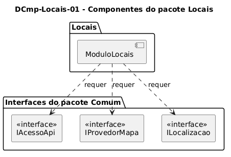

# DCmp-Locais-01 – Componentes do pacote Locais

| Campo | Valor |
|---|---|
| **Código** | `DCmp-Locais-01` |
| **Título** | Componentes do pacote Locais |
| **Autor(a)** | Maicon Brendo da Silva |
| **Revisor(a)** | Revisor(a) a definir |
| **Status** | Em produção |
| **Rastreia para** | `DPac-Geral-01`, `DImp-Geral-01`, `DCmp-Comum-01`, `DCla-Locais-01`, `DCla-Locais-02` |

## Diagrama

Fonte: [`DCmp-Locais-01.puml`](DCmp-Locais-01.puml)

## Descrição

O diagrama ilustra a visão de componentes de software para o módulo `Locais` e suas interfaces requeridas em relação ao subsistema compartilhado `Comum`.

### Dependências Arquiteturais

- **`ModuloLocais`:** Componente autônomo responsável pela gerência da lista de prédios, alternância de abas, visualização de mapas e centralização geográfica.
- **Interfaces Requeridas do pacote Comum:**
  - `IAcessoApi`: Requerida para a busca assíncrona de dados via HTTP REST no servidor (`DCmp-Comum-01`).
  - `IProvedorMapa`: Requerida para a renderização da malha cartográfica, posicionamento da câmera e gerenciamento de marcadores coloridos (`DCla-Comum-04`).
  - `ILocalizacao`: Requerida para a verificação de permissão e leitura das coordenadas do sensor de GPS do dispositivo (`DCla-Comum-04`).

## Referências

GOOGLE. **Antigravity**. Assistente de IA para Engenharia de Software. Disponível em: https://antigravity.google.com. Acesso em: 30 out. 2026.

INSTITUTE OF ELECTRICAL AND ELECTRONICS ENGINEERS. **Guide to the Software Engineering Body of Knowledge – SWEBOK v4**. Cap. 3 (Software Design). IEEE, 2024.

---

## Registro de revisão

| Data | Revisor(a) | Situação | Observações |
|---|---|---|---|
| | | | |

