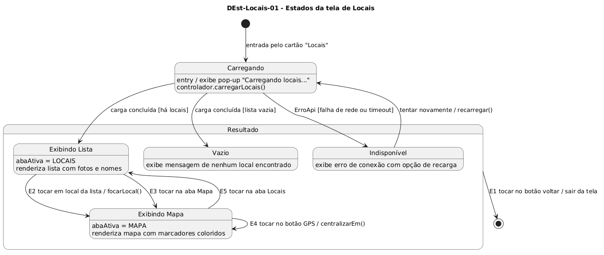

# DEst-Locais-01 – Estados da tela de Locais

| Campo | Valor |
|---|---|
| **Código** | `DEst-Locais-01` |
| **Título** | Estados da tela de Locais |
| **Autor(a)** | Maicon Brendo da Silva |
| **Revisor(a)** | Revisor(a) a definir |
| **Status** | Em produção |
| **Rastreia para** | `DCdu-Locais-01`, `DIhc-Locais-01`, `DIhc-Locais-02`, `DEst-Comum-01`, `DSeq-Locais-01`, `DSeq-Locais-02`, `DSeq-Locais-03` |

## Diagrama

Fonte: [`DEst-Locais-01.puml`](DEst-Locais-01.puml)

## Descrição

O diagrama de transição de estados modela o ciclo de vida da interface de usuário da funcionalidade Locais, integrando os estados remotos padrão estabelecidos em `DEst-Comum-01` (`CARREGANDO`, `EXIBINDO`, `VAZIO`, `INDISPONIVEL`) com a alternância entre as duas abas visuais da tela ("Aba Locais" e "Aba Mapa").

### Estados da Interface

- **`Carregando`:** Estado transitório ativado logo após o toque no cartão da tela inicial. O app exibe o pop-up nativo *"Carregando locais..."* enquanto o controlador assíncrono busca os dados na API.
- **`Resultado` (Super-estado):** Estado composto ativado após a conclusão da requisição remota:
  - **`Exibindo Lista`:** Sub-estado ativo quando a aba selecionada é "Locais", exibindo a lista rolável com miniaturas fotográficas e títulos dos prédios sob o cabeçalho "Campus Samambaia".
  - **`Exibindo Mapa`:** Sub-estado ativo quando a aba selecionada é "Mapa", apresentando a malha cartográfica do campus com os marcadores coloridos e o botão flutuante de GPS.
  - **`Vazio`:** Apresenta mensagem informativa caso o servidor retorne uma lista sem nenhum local cadastrado.
  - **`Indisponível`:** Apresenta tela de aviso de falha de conexão ou timeout na comunicação com a API, contendo botão para nova tentativa de carga (`recarregar()`).

### Transições de interface

| Transição | Evento disparador | Guarda / Condição | Efeito / Ação |
|---|---|---|---|
| Carga bem-sucedida | Conclusão da API | `[há locais]` | Fecha pop-up e transiciona para `Exibindo Lista` |
| Falha de rede | Erro de comunicação | `[ErroApi]` | Fecha pop-up e transiciona para `Indisponível` |
| Foco no mapa | Evento `E2` (toque em item da lista) | – | Alterna para `Exibindo Mapa`, centraliza na coordenada e destaca marcador |
| Troca para Mapa | Evento `E3` (toque na aba Mapa) | – | Alterna para `Exibindo Mapa` na visão panorâmica do campus |
| Troca para Lista | Evento `E5` (toque na aba Locais) | – | Alterna de volta para `Exibindo Lista` |
| Centralização GPS | Evento `E4` (toque no botão mira) | – | Solicita precisão e recentraliza a câmera do mapa |
| Saída da tela | Evento `E1` (botão voltar) | – | Desaloca a tela de Locais e restaura a tela inicial |

## Referências

GOOGLE. **Antigravity**. Assistente de IA para Engenharia de Software. Disponível em: https://antigravity.google.com. Acesso em: 30 out. 2026.

INSTITUTE OF ELECTRICAL AND ELECTRONICS ENGINEERS. **Guide to the Software Engineering Body of Knowledge – SWEBOK v4**. Cap. 11 (Software Engineering Models and Methods). IEEE, 2024.

---

## Registro de revisão

| Data | Revisor(a) | Situação | Observações |
|---|---|---|---|
| | | | |

