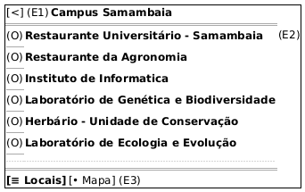

# DIhc-Locais-01 – Interface da lista de locais

| Campo | Valor |
|---|---|
| **Código** | `DIhc-Locais-01` |
| **Título** | Interface da lista de locais |
| **Autor(a)** | Maicon Brendo da Silva |
| **Revisor(a)** | Revisor(a) a definir |
| **Status** | Em produção |
| **Rastreia para** | `DCdu-Locais-01`, `DAtv-Locais-01`, `DIhc-Locais-02`, `DEst-Locais-01`, `DSeq-Locais-02` |

## Diagrama

Fonte: [`DIhc-Locais-01.puml`](DIhc-Locais-01.puml)

## Descrição

O protótipo de IHC em notação Salt modela a aba inicial da funcionalidade Locais ("Aba Locais") na versão 3.1.1 do app Minha UFG, obtida por engenharia reversa das capturas de tela reais.

A interface apresenta uma barra superior azul com botão voltar e o título "Campus Samambaia", uma lista rolável com fotos circulares em miniatura e os nomes dos locais da UFG, além de uma barra de navegação inferior com as abas "Locais" (ativa) e "Mapa".

### Mapeamento de eventos de interação

| Evento | Elemento disparador | Origem | Ação / Efeito no app |
|---|---|---|---|
| **E1** | Botão voltar `[<]` na barra de topo | Usuário $\rightarrow$ App | Retorna para a tela inicial do Minha UFG |
| **E2** | Toque em qualquer local da lista (ex.: *Instituto de Informática*) | Usuário $\rightarrow$ App | Alterna para a aba "Mapa", centraliza a coordenada do local e destaca o marcador circular correspondente (`DSeq-Locais-02`) |
| **E3** | Toque na aba inferior `[• Mapa]` | Usuário $\rightarrow$ App | Alterna para a aba "Mapa" na visão panorâmica geral do Campus Samambaia |

## Referências

GOOGLE. **Antigravity**. Assistente de IA para Engenharia de Software. Disponível em: https://antigravity.google.com. Acesso em: 30 out. 2026.

INSTITUTE OF ELECTRICAL AND ELECTRONICS ENGINEERS. **Guide to the Software Engineering Body of Knowledge – SWEBOK v4**. Cap. 11 (Software Engineering Models and Methods). IEEE, 2024.

---

## Registro de revisão

| Data | Revisor(a) | Situação | Observações |
|---|---|---|---|
| | | | |

