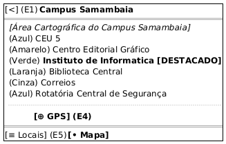

# DIhc-Locais-02 – Interface do mapa de locais com GPS

| Campo | Valor |
|---|---|
| **Código** | `DIhc-Locais-02` |
| **Título** | Interface do mapa de locais com GPS |
| **Autor(a)** | Maicon Brendo da Silva |
| **Revisor(a)** | Revisor(a) a definir |
| **Status** | Em produção |
| **Rastreia para** | `DCdu-Locais-01`, `DAtv-Locais-02`, `DAtv-Locais-03`, `DIhc-Locais-01`, `DEst-Locais-01`, `DSeq-Locais-03` |

## Diagrama

Fonte: [`DIhc-Locais-02.puml`](DIhc-Locais-02.puml)

## Descrição

O protótipo de IHC em notação Salt modela a aba do mapa ("Aba Mapa") da funcionalidade Locais na versão 3.1.1 do app Minha UFG, obtida por engenharia reversa das capturas de tela reais.

A tela compreende a barra superior azul com o título "Campus Samambaia", a área cartográfica renderizada pelo provedor de mapa contendo as vias, áreas do campus e os marcadores circulares coloridos por categoria de ponto de interesse, o botão de ação flutuante (FAB) de mira/GPS no canto inferior direito, e a barra inferior de navegação com a aba "Mapa" ativa.

### Mapeamento de eventos de interação

| Evento | Elemento disparador | Origem | Ação / Efeito no app |
|---|---|---|---|
| **E1** | Botão voltar `[<]` na barra de topo | Usuário $\rightarrow$ App | Retorna para a tela inicial do Minha UFG |
| **E4** | Botão flutuante de GPS `[⊕]` | Usuário $\rightarrow$ App | Solicita verificação de precisão/permissão de geolocalização e centraliza a visualização na posição atual do usuário (`DSeq-Locais-03`) |
| **E5** | Toque na aba inferior `[≡ Locais]` | Usuário $\rightarrow$ App | Alterna a interface de volta para a aba da lista de locais (`DIhc-Locais-01`) |

## Referências

GOOGLE. **Antigravity**. Assistente de IA para Engenharia de Software. Disponível em: https://antigravity.google.com. Acesso em: 30 out. 2026.

INSTITUTE OF ELECTRICAL AND ELECTRONICS ENGINEERS. **Guide to the Software Engineering Body of Knowledge – SWEBOK v4**. Cap. 11 (Software Engineering Models and Methods). IEEE, 2024.

---

## Registro de revisão

| Data | Revisor(a) | Situação | Observações |
|---|---|---|---|
| | | | |

