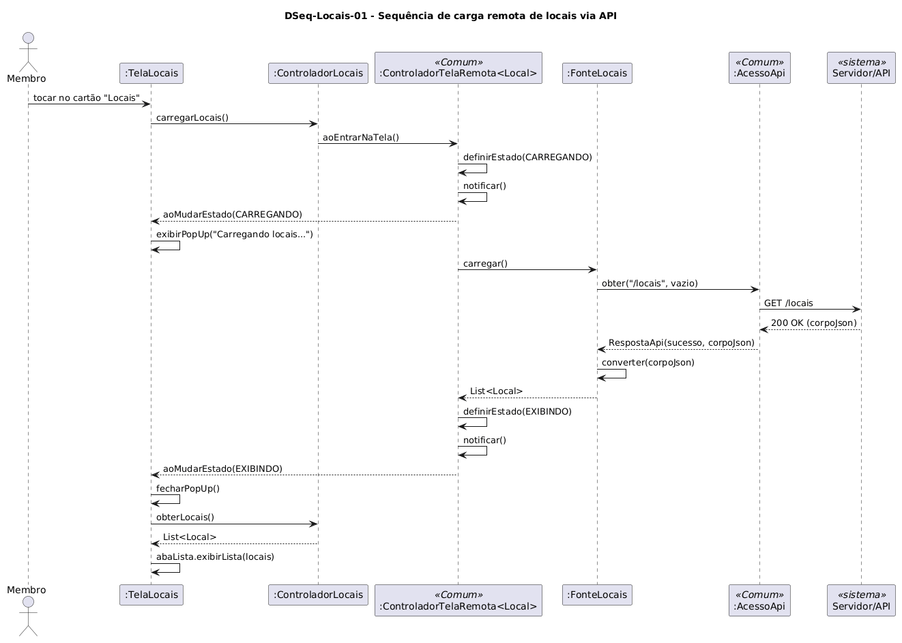

# DSeq-Locais-01 – Sequência de carga remota de locais via API

| Campo | Valor |
|---|---|
| **Código** | `DSeq-Locais-01` |
| **Título** | Sequência de carga remota de locais via API |
| **Autor(a)** | Maicon Brendo da Silva |
| **Revisor(a)** | Revisor(a) a definir |
| **Status** | Em produção |
| **Rastreia para** | `DCdu-Locais-01`, `DAtv-Locais-01`, `DIhc-Locais-01`, `DCla-Locais-01`, `DCla-Locais-02`, `DCla-Comum-02`, `DCla-Comum-03` |

## Diagrama

Fonte: [`DSeq-Locais-01.puml`](DSeq-Locais-01.puml)

## Descrição

O diagrama detalha a sequência de troca de mensagens assíncrona executada quando o usuário entra na funcionalidade Locais a partir da tela inicial.

### Dinâmica das mensagens

1. O usuário aciona o cartão "Locais". A interface `TelaLocais` renderiza a mensagem transitória "Carregando locais..." e solicita a carga ao `ControladorLocais`.
2. O controlador delega a operação para `IControladorTelaRemota<Local>` (`aoEntrarNaTela()`), que notifica a tela sobre a transição para o estado `CARREGANDO`.
3. O controlador remoto invoca a fonte de dados `FonteLocais.carregar()`, que por sua vez utiliza o componente de rede `IAcessoApi.obter("/locais")` para enviar uma requisição HTTP REST ao `Servidor/API`.
4. Ao receber o código 200 OK com o JSON de locais, a classe `FonteLocais` realiza a desserialização polimórfica (instanciando `Local` e `UnidadeAcademica`).
5. A lista resultante é repassada ao `ControladorTelaRemota`, que atualiza o estado para `EXIBINDO` e notifica `TelaLocais`.
6. A tela encerra o pop-up de carregamento e entrega a lista para `AbaListaLocais.exibirLista()`, apresentando a relação de prédios e fotos na interface.

## Referências

GOOGLE. **Antigravity**. Assistente de IA para Engenharia de Software. Disponível em: https://antigravity.google.com. Acesso em: 30 out. 2026.

INSTITUTE OF ELECTRICAL AND ELECTRONICS ENGINEERS. **Guide to the Software Engineering Body of Knowledge – SWEBOK v4**. Cap. 11 (Software Engineering Models and Methods). IEEE, 2024.

---

## Registro de revisão

| Data | Revisor(a) | Situação | Observações |
|---|---|---|---|
| | | | |

