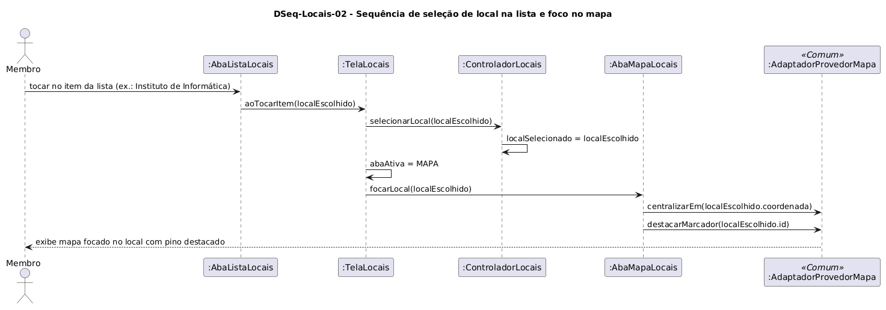

# DSeq-Locais-02 – Sequência de seleção de local na lista e foco no mapa

| Campo | Valor |
|---|---|
| **Código** | `DSeq-Locais-02` |
| **Título** | Sequência de seleção de local na lista e foco no mapa |
| **Autor(a)** | Maicon Brendo da Silva |
| **Revisor(a)** | Revisor(a) a definir |
| **Status** | Em produção |
| **Rastreia para** | `DCdu-Locais-01`, `DAtv-Locais-02`, `DIhc-Locais-01`, `DIhc-Locais-02`, `DCla-Locais-01`, `DCla-Comum-04` |

## Diagrama

Fonte: [`DSeq-Locais-02.puml`](DSeq-Locais-02.puml)

## Descrição

O diagrama detalha a sequência de mensagens executada quando o usuário toca em um dos itens da lista de locais (evento `E2` de `DIhc-Locais-01`), gerando a transição automática para a aba do mapa com a câmera centralizada nas coordenadas do prédio e o marcador em destaque.

### Dinâmica das mensagens

1. O usuário toca em um item da lista na camada de apresentação (`AbaListaLocais`).
2. O evento é repassado para `TelaLocais.aoTocarItem(localEscolhido)`.
3. A tela notifica o `ControladorLocais.selecionarLocal()`, que registra a entidade selecionada em memória.
4. A tela altera a propriedade `abaAtiva` para `MAPA`, disparando a renderização da aba cartográfica.
5. A tela invoca `AbaMapaLocais.focarLocal(localEscolhido)`.
6. A sub-visão do mapa aciona a interface `IProvedorMapa` (implementada por `AdaptadorProvedorMapa` do pacote `Comum`):
   - `centralizarEm(localEscolhido.coordenada)`: Reposiciona a câmera geográfica.
   - `destacarMarcador(localEscolhido.id)`: Altera a escala e o estilo visual do pino circular correspondente.
7. O usuário visualiza o mapa devidamente posicionado e focado no local selecionado.

## Referências

GOOGLE. **Antigravity**. Assistente de IA para Engenharia de Software. Disponível em: https://antigravity.google.com. Acesso em: 30 out. 2026.

INSTITUTE OF ELECTRICAL AND ELECTRONICS ENGINEERS. **Guide to the Software Engineering Body of Knowledge – SWEBOK v4**. Cap. 11 (Software Engineering Models and Methods). IEEE, 2024.

---

## Registro de revisão

| Data | Revisor(a) | Situação | Observações |
|---|---|---|---|
| | | | |

