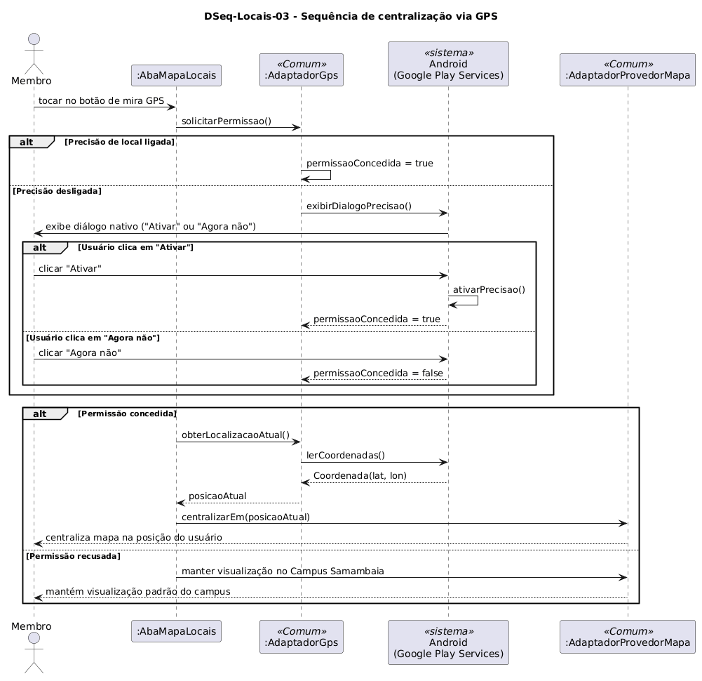

# DSeq-Locais-03 – Sequência de centralização via GPS

| Campo | Valor |
|---|---|
| **Código** | `DSeq-Locais-03` |
| **Título** | Sequência de centralização via GPS |
| **Autor(a)** | Maicon Brendo da Silva |
| **Revisor(a)** | Revisor(a) a definir |
| **Status** | Em produção |
| **Rastreia para** | `DCdu-Locais-01`, `DAtv-Locais-03`, `DIhc-Locais-02`, `DCla-Locais-01`, `DCla-Comum-04` |

## Diagrama

Fonte: [`DSeq-Locais-03.puml`](DSeq-Locais-03.puml)

## Descrição

O diagrama detalha a sequência de troca de mensagens correspondente à ação em que o usuário toca no botão flutuante de GPS (evento `E4` de `DIhc-Locais-02`) para obter sua posição atual no campus.

### Dinâmica das mensagens

1. O usuário toca no botão com ícone de mira/GPS em `AbaMapaLocais`.
2. A sub-visão aciona o adaptador de GPS (`AdaptadorGps`, realização de `ILocalizacao` do pacote `Comum`) através de `solicitarPermissao()`.
3. Caso a precisão esteja ativa, a permissão é confirmada imediatamente. Caso esteja desligada, o sistema operacional Android (Google Play Services) exibe o diálogo nativo *"Para uma experiência melhor, o dispositivo precisa usar a Precisão de Local"*:
   - Se o usuário selecionar "Ativar", o Android liga o sensor e a permissão é confirmada como verdadeira.
   - Se o usuário selecionar "Agora não", a permissão é retornada como falsa.
4. Havendo permissão concedida, `AbaMapaLocais` invoca `obterLocalizacaoAtual()`, recebendo uma instância de `Coordenada(lat, lon)`, e repassa para `AdaptadorProvedorMapa.centralizarEm(posicaoAtual)`.
5. Em caso de recusa da permissão, o app preserva o mapa centralizado nas coordenadas padrão do Campus Samambaia com os marcadores da UFG mantidos visíveis.

## Referências

GOOGLE. **Antigravity**. Assistente de IA para Engenharia de Software. Disponível em: https://antigravity.google.com. Acesso em: 30 out. 2026.

INSTITUTE OF ELECTRICAL AND ELECTRONICS ENGINEERS. **Guide to the Software Engineering Body of Knowledge – SWEBOK v4**. Cap. 11 (Software Engineering Models and Methods). IEEE, 2024.

---

## Registro de revisão

| Data | Revisor(a) | Situação | Observações |
|---|---|---|---|
| | | | |

