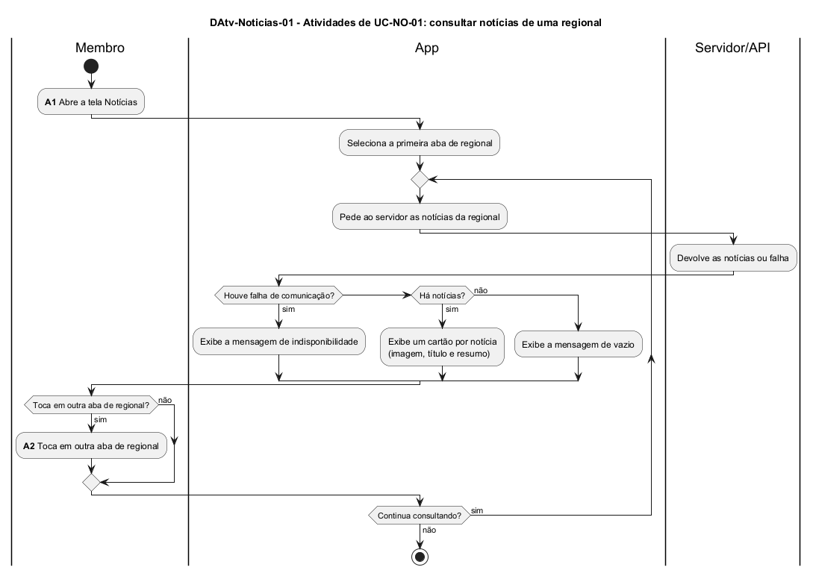

# DAtv-Noticias-01 – Atividades de UC-NO-01: consultar notícias de uma regional

| Campo | Valor |
|---|---|
| **Código** | `DAtv-Noticias-01` |
| **Título** | Atividades de UC-NO-01: consultar notícias de uma regional |
| **Autor(a)** | José Eduardo Gontijo de Carvalho (Pessoa C) |
| **Revisor(a)** | Phablo Tavares Paixão (Pessoa D) |
| **Status** | Em produção (primeira versão) |
| **Rastreia para** | `DCdu-Noticias-01`, `DIhc-Noticias-01`, `DEst-Comum-01` |

## Diagrama

Fonte: [`DAtv-Noticias-01.puml`](DAtv-Noticias-01.puml)

## Descrição

Fluxo do caso de uso UC-NO-01 em raias: Membro, App e Servidor/API. As ações de interação com o app são **A1 – abrir a tela Notícias** e **A2 – tocar em outra aba de regional**. Os diagramas de sequência delas (`DSeq-Noticias-01` e `02`) serão produzidos na etapa de classes e sequências. A chamada ao servidor e a exibição do resultado fazem parte de cada atividade (contrato-base, seção 6), com os desfechos do ciclo genérico de `DEst-Comum-01`.

As premissas `P-NO-n` citadas estão listadas, com o que as capturas de tela do app (versão 3.2.0) confirmaram e o que falta confirmar, em [`Noticias/README.md`](README.md).

## Referências

INSTITUTE OF ELECTRICAL AND ELECTRONICS ENGINEERS. **Guide to the Software Engineering Body of Knowledge – SWEBOK v4**. Cap. 11 (Software Engineering Models and Methods). IEEE, 2024.

---

## Registro de revisão

| Data | Revisor(a) | Situação | Observações |
|---|---|---|---|
| | | | |
