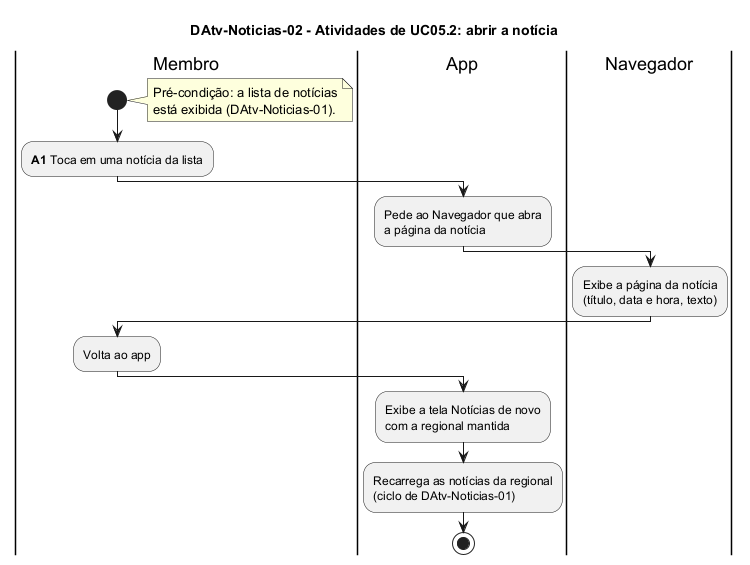

# DAtv-Noticias-02 – Atividades de UC05.2: abrir a notícia

| Campo | Valor |
|---|---|
| **Código** | `DAtv-Noticias-02` |
| **Título** | Atividades de UC05.2: abrir a notícia |
| **Autor(a)** | José Eduardo Gontijo de Carvalho (Pessoa C) |
| **Revisor(a)** | Phablo Tavares Paixão (Pessoa D) |
| **Status** | Em produção |
| **Rastreia para** | `DCdu-Noticias-01`, `DIhc-Noticias-01`, `DCla-Comum-01`, `DAtv-Noticias-01`, `DSeq-Noticias-03` |

## Diagrama

Fonte: [`DAtv-Noticias-02.puml`](DAtv-Noticias-02.puml)

## Descrição

Fluxo do caso de uso UC05.2 do `DCdu-Noticias-01`, em raias: Membro, App e Navegador. A ação de interação é **A1 – tocar em uma notícia** (evento E2 do `DIhc-Noticias-01`, sequência em `DSeq-Noticias-03`). O app pede ao Navegador que abra o endereço da notícia por meio do componente LinkExterno do Comum (`ILinkExterno.abrirUrl`, `DCla-Comum-01`), e o Navegador exibe a página no portal da UFG: título, data e hora de publicação ("Em dd/mm/aa hh:mm."), texto e os créditos "Texto:" e "Foto de capa:" (capturas 12 e 20 da versão 3.2.0; os créditos ficam fora do modelo do app). A data só aparece nessa página, não no cartão da lista. O resultado da abertura foi observado; o toque no cartão, em si, não foi capturado (P-NO-3).

Ao voltar do Navegador, o app exibe a tela de Notícias de novo e, pela regra global de recarga ao entrar na tela (`DEst-Comum-01`), carrega as notícias outra vez, com a regional que estava selecionada (`DAtv-Noticias-01`). O resultado de `abrirUrl` não é usado: o app atual não mostra mensagem se o endereço for inválido ou não houver navegador (`DCla-Comum-01`).

A premissa P-NO-3 está na tabela de [`Noticias/README.md`](README.md), com o que as capturas de tela do app (versão 3.2.0) confirmaram e o que falta confirmar.

## Referências

INSTITUTE OF ELECTRICAL AND ELECTRONICS ENGINEERS. **Guide to the Software Engineering Body of Knowledge – SWEBOK v4**. Cap. 11 (Software Engineering Models and Methods). IEEE, 2024.

ANTHROPIC. **Claude Code**. Assistente de IA. Disponível em: claude.ai/code. Acesso em: 30 out. 2026. Uso: apoio à redação e aos diagramas, a partir das instruções, das capturas de tela e das correções do autor (resumo em `IA/registro-C.md`). Questão: Apêndice <X>, Seção <X.1>.

---

## Registro de revisão

| Data | Revisor(a) | Situação | Observações |
|---|---|---|---|
| | | | |
