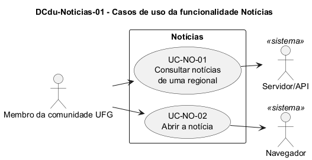

# DCdu-Noticias-01 – Casos de uso da funcionalidade Notícias

| Campo | Valor |
|---|---|
| **Código** | `DCdu-Noticias-01` |
| **Título** | Casos de uso da funcionalidade Notícias |
| **Autor(a)** | José Eduardo Gontijo de Carvalho (Pessoa C) |
| **Revisor(a)** | Phablo Tavares Paixão (Pessoa D) |
| **Status** | Em produção (primeira versão) |
| **Rastreia para** | `DCdu-Geral-01`, `DAtv-Noticias-01`, `DAtv-Noticias-02`, `DIhc-Noticias-01` |

## Diagrama

Fonte: [`DCdu-Noticias-01.puml`](DCdu-Noticias-01.puml)

## Descrição

Detalha o caso de uso macro "Consultar notícias" do `DCdu-Geral-01` em dois casos de uso. O ator primário é o Membro da comunidade UFG (anônimo). Os atores secundários são o Servidor/API, que fornece as notícias cadastradas pelo painel web, e o Navegador, que abre a notícia no site da UFG. O app não tem tela de detalhe da notícia: tocar em um item abre a página dela no navegador (confirmado nas capturas de tela da versão 3.2.0), pelo componente `LinkExterno` (`DCla-Comum-01`).

**Tabela 1 – Casos de uso de Notícias**

| Código | Caso de uso | Objetivo do usuário | Atores secundários |
|---|---|---|---|
| UC-NO-01 | Consultar notícias de uma regional | Ver as notícias mais recentes de uma regional | Servidor/API |
| UC-NO-02 | Abrir a notícia | Ler a notícia completa no site da UFG | Navegador |

**UC-NO-01 – Consultar notícias de uma regional**

- *Pré-condição:* o usuário tocou no cartão Notícias do menu inicial.
- *Fluxo principal:* (1) o app seleciona a primeira regional da faixa de abas, que na captura é Goiânia (P-NO-2); (2) o app pede ao servidor as notícias da regional; (3) o app lista as notícias, cada uma em um cartão com imagem, título e um resumo curto (P-NO-3); (4) o usuário pode tocar em outra aba de regional (P-NO-1), e o fluxo volta ao passo 2.
- *Fluxos alternativos:* **A1** a regional não tem notícias: o app mostra a mensagem de vazio; **A2** sem internet ou servidor indisponível: o app mostra a mensagem de indisponibilidade (`DEst-Comum-01`).
- *Pós-condição:* a tela mostra as notícias da regional selecionada.

**UC-NO-02 – Abrir a notícia**

- *Pré-condição:* a lista exibe ao menos uma notícia.
- *Fluxo principal:* (1) o usuário toca em uma notícia; (2) o app pede ao Navegador que abra a página dela, no portal de notícias da UFG; (3) o Navegador exibe a página, que mostra o título e a data e hora de publicação.
- *Fluxos alternativos:* **A1** endereço inválido ou nenhum navegador disponível: o app atual não mostra mensagem (`DCla-Comum-01`).
- *Pós-condição:* ao voltar ao app, a tela recarrega as notícias (sem cache).

As premissas `P-NO-n` citadas estão listadas, com o que as capturas de tela do app (versão 3.2.0) confirmaram e o que falta confirmar, em [`Noticias/README.md`](README.md).

## Referências

INSTITUTE OF ELECTRICAL AND ELECTRONICS ENGINEERS. **Guide to the Software Engineering Body of Knowledge – SWEBOK v4**. Cap. 11 (Software Engineering Models and Methods). IEEE, 2024.

---

## Registro de revisão

| Data | Revisor(a) | Situação | Observações |
|---|---|---|---|
| | | | |
