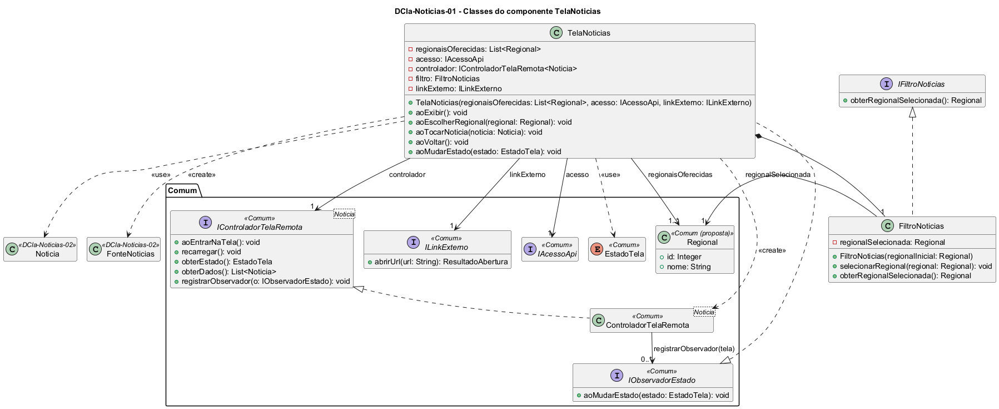

# DCla-Noticias-01 – Classes do componente TelaNoticias

| Campo | Valor |
|---|---|
| **Código** | `DCla-Noticias-01` |
| **Título** | Classes do componente TelaNoticias |
| **Autor(a)** | José Eduardo Gontijo de Carvalho (Pessoa C) |
| **Revisor(a)** | Phablo Tavares Paixão (Pessoa D) |
| **Status** | Em produção |
| **Rastreia para** | `DCmp-Noticias-01`, `DCla-Noticias-02`, `DCla-Comum-01`, `DCla-Comum-02`, `DCla-Comum-03`, `DIhc-Noticias-01`, `DSeq-Noticias-01`, `DSeq-Noticias-02`, `DSeq-Noticias-03`, `DEst-Noticias-01`, `Contrato-Noticias-01`, `DD-Noticias-01`, `DD-Eventos-01` |

## Diagrama

Fonte: [`DCla-Noticias-01.puml`](DCla-Noticias-01.puml)

## Descrição

Classes do componente TelaNoticias.

- **TelaNoticias** representa a tela. Cada método `ao...` corresponde a um evento de interação do protótipo (`DIhc-Noticias-01`): `aoExibir` (E0, entrada e retorno), `aoEscolherRegional` (E1), `aoTocarNoticia` (E2) e `aoVoltar` (E3). Implementa `IObservadorEstado` (pacote Comum, `DCla-Comum-03`) e, em `aoMudarEstado`, mostra o indicador de carregamento (`CARREGANDO`), a faixa de abas e a lista de cartões lida com `controlador.obterDados()` (`EXIBINDO`), a mensagem de vazio (`VAZIO`, não observado, P-NO-9) ou a tela em branco, sem abas e sem mensagem (`INDISPONIVEL`, captura 31, P-NO-8). A faixa de abas só é mostrada em `EXIBINDO`; a barra de título, com a seta de voltar, é fixa em todos os estados.
  - **`regionaisOferecidas: List<Regional>`:** lista fixa de regionais, recebida na construção; a regional inicial é a primeira da lista (P-NO-2). Nas capturas só a aba "GOIÂNIA" é visível; o conteúdo da lista fixa é pendente (P-NO-6).
  - **Criação e registro.** Na primeira exibição (entrada pelo menu), `aoExibir` cria o `FiltroNoticias` com a regional inicial, cria a `FonteNoticias` (`DCla-Noticias-02`) com o `acesso` e o filtro, cria o `ControladorTelaRemota<Noticia>` do Comum com essa fonte e **se registra como observador** do controlador (`controlador.registrarObservador(this)`); depois chama `controlador.aoEntrarNaTela()`. No retorno do Navegador esses objetos são mantidos, e a regional escolhida também (`DSeq-Noticias-01` e `DSeq-Noticias-03`).
  - **`aoEscolherRegional`:** só ocorre em `EXIBINDO`, único estado em que a faixa de abas aparece (P-NO-1); grava a regional no filtro e chama `controlador.recarregar()`.
  - **`aoTocarNoticia`:** chama `linkExterno.abrirUrl(noticia.url)` e descarta o resultado. Não há tela de detalhe.
  - **`aoVoltar`:** encerra a tela e descarta o filtro e as notícias em memória.
- **IControladorTelaRemota\<Noticia\>** (Comum) aparece com todas as suas operações atuais (`aoEntrarNaTela`, `recarregar`, `obterEstado`, `obterDados`, `registrarObservador`); a tela usa `aoEntrarNaTela`, `recarregar`, `obterDados` e `registrarObservador`. `ControladorTelaRemota<Noticia>` é a implementação do Comum, só instanciada aqui.
- **FiltroNoticias** guarda a regional selecionada. Implementa `IFiltroNoticias`, interface que a `FonteNoticias` usa para ler a regional (`DCla-Noticias-02`). Diferente de Eventos, não há mês nem data: o único filtro de Notícias é a regional.
- **Regional** é entidade de dono Pessoa C, compartilhada com Eventos e Locais (`DD-Eventos-01`). Aparece aqui só como referência; sua localização no `DPac-Geral-01` é pendência da integração (D-INT-03), e a proposta da Pessoa C é mantê-la em `Comum`.

As classes e interfaces dos estereótipos `<<Comum>>` pertencem ao pacote Comum e não são redefinidas aqui. Os contratos das operações estão em `Contrato-Noticias-01`.

As premissas P-NO-1, P-NO-2, P-NO-6, P-NO-8 e P-NO-9 estão na tabela de [`Noticias/README.md`](README.md), com o que as capturas de tela do app (versão 3.2.0) confirmaram e o que falta confirmar.

## Referências

INSTITUTE OF ELECTRICAL AND ELECTRONICS ENGINEERS. **Guide to the Software Engineering Body of Knowledge – SWEBOK v4**. Cap. 3 (Software Design). IEEE, 2024.

ANTHROPIC. **Claude Code**. Assistente de IA. Disponível em: claude.ai/code. Acesso em: 30 out. 2026. Uso: apoio à redação e aos diagramas, a partir das instruções, das capturas de tela e das correções do autor (resumo em `IA/registro-C.md`). Questão: Apêndice <X>, Seção <X.1>.

---

## Registro de revisão

| Data | Revisor(a) | Situação | Observações |
|---|---|---|---|
| | | | |
