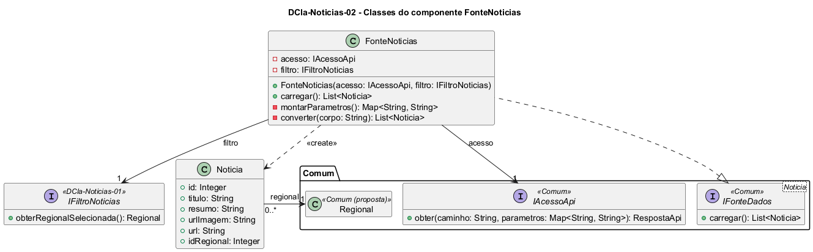

# DCla-Noticias-02 – Classes do componente FonteNoticias

| Campo | Valor |
|---|---|
| **Código** | `DCla-Noticias-02` |
| **Título** | Classes do componente FonteNoticias |
| **Autor(a)** | José Eduardo Gontijo de Carvalho (Pessoa C) |
| **Revisor(a)** | Phablo Tavares Paixão (Pessoa D) |
| **Status** | Em produção |
| **Rastreia para** | `DCmp-Noticias-01`, `DCla-Comum-02`, `DCla-Comum-03`, `DCla-Noticias-01`, `DSeq-Noticias-01`, `Contrato-Noticias-01`, `DD-Noticias-01`, `DD-Eventos-01` |

## Diagrama

Fonte: [`DCla-Noticias-02.puml`](DCla-Noticias-02.puml)

## Descrição

Classes do componente FonteNoticias.

- **FonteNoticias** implementa a interface `IFonteDados<Noticia>` do pacote Comum (`DCla-Comum-03`). Em `carregar()`, lê a regional pela `IFiltroNoticias`, monta os parâmetros (`regional`), consulta a API com `IAcessoApi.obter("/noticias", ...)` (`DCla-Comum-02`) e converte o JSON em uma lista de `Noticia`, na ordem em que a API devolve (P-NO-5). Não trata falhas: o `ErroApi` lançado pelo acesso à API segue até o controlador de estados, que define o estado Indisponível. Não há cache: cada entrada na tela chama `carregar()` de novo.
- **Noticia** é a entidade exibida na lista: título, resumo (opcional), endereço da imagem do banner (opcional), endereço da página no portal da UFG (`url`) e a regional (`idRegional`). Não tem data de publicação: a data só aparece na página do portal aberta no Navegador, não no cartão (capturas 12 e 20 da versão 3.2.0), e por isso fica fora do modelo. Atributos completos no dicionário de dados (`DD-Noticias-01`).
- **Regional** é só referenciada (`DD-Eventos-01`), como em `DCla-Noticias-01`.
- A conversão do JSON em objetos fica nesta fonte, e não no pacote Comum, porque só a funcionalidade conhece o formato (`DCla-Comum-02`). A rota `/noticias` e o formato da resposta são premissa de projeto (P-NO-4): o app real não deixa o contrato da API visível.

Os contratos das operações estão em `Contrato-Noticias-01`.

As premissas P-NO-4 e P-NO-5 estão na tabela de [`Noticias/README.md`](README.md), com o que as capturas de tela do app (versão 3.2.0) confirmaram e o que falta confirmar.

## Referências

INSTITUTE OF ELECTRICAL AND ELECTRONICS ENGINEERS. **Guide to the Software Engineering Body of Knowledge – SWEBOK v4**. Cap. 3 (Software Design). IEEE, 2024.

ANTHROPIC. **Claude Code**. Assistente de IA. Disponível em: claude.ai/code. Acesso em: 30 out. 2026. Uso: apoio à redação e aos diagramas, a partir das instruções, das capturas de tela e das correções do autor (resumo em `IA/registro-C.md`). Questão: Apêndice <X>, Seção <X.1>.

---

## Registro de revisão

| Data | Revisor(a) | Situação | Observações |
|---|---|---|---|
| | | | |
