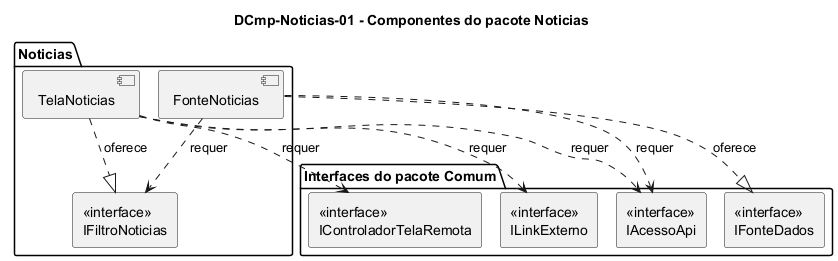

# DCmp-Noticias-01 – Componentes do pacote Noticias

| Campo | Valor |
|---|---|
| **Código** | `DCmp-Noticias-01` |
| **Título** | Componentes do pacote Noticias |
| **Autor(a)** | José Eduardo Gontijo de Carvalho (Pessoa C) |
| **Revisor(a)** | Phablo Tavares Paixão (Pessoa D) |
| **Status** | Em produção |
| **Rastreia para** | `DPac-Geral-01`, `DCmp-Comum-01`, `DCla-Noticias-01`, `DCla-Noticias-02`, `DSeq-Noticias-01` |

## Diagrama

Fonte: [`DCmp-Noticias-01.puml`](DCmp-Noticias-01.puml)

## Descrição

O pacote `Noticias` tem dois componentes. Eles dependem do pacote `Comum` apenas por interfaces, como pede o `DPac-Geral-01`, e não dependem de nenhum outro pacote de funcionalidade. A única referência a outro pacote é a entidade `Regional`, de dono C, cuja localização é pendência da integração (`DD-Eventos-01`, `DPac-Geral-01`).

**Tabela 1 – Componentes do pacote Noticias**

| Componente | Responsabilidade | Interface oferecida | Interfaces requeridas (pacote Comum) | Classes |
|---|---|---|---|---|
| TelaNoticias | Exibe a barra de título (fixa), a faixa de abas de regional (só com a lista exibida, rolando junto com ela, capturas 16, 18 e 31) e a lista de cartões; guarda a regional selecionada; trata os toques do usuário; cria o controlador de estados | `IFiltroNoticias` | `IControladorTelaRemota`, `ILinkExterno`, `IAcessoApi` (só para entregá-la à fonte) | `DCla-Noticias-01` |
| FonteNoticias | Busca as notícias da regional selecionada na API e as converte em objetos `Noticia` | `IFonteDados` (implementada para `Noticia`) | `IAcessoApi`, `IFiltroNoticias` | `DCla-Noticias-02` |

**Como os componentes cooperam.** A `TelaNoticias` cria um controlador de estados (`ControladorTelaRemota<Noticia>`, pacote Comum) e entrega a ele a `FonteNoticias` como fonte de dados. Quando a regional muda, a tela pede `recarregar()` ao controlador, e a `FonteNoticias` lê a nova regional pela interface `IFiltroNoticias`. Esse desenho segue o modelo de uso descrito em `DCmp-Comum-01` e é o mesmo de `DCmp-Eventos-01`.

**Decisão de projeto.** O estado do filtro (a regional selecionada) fica na tela e é lido pela fonte por uma interface. Assim, a fonte não conhece a interface gráfica e pode ser testada sozinha.

## Referências

INSTITUTE OF ELECTRICAL AND ELECTRONICS ENGINEERS. **Guide to the Software Engineering Body of Knowledge – SWEBOK v4**. Cap. 3 (Software Design). IEEE, 2024.

ANTHROPIC. **Claude Code**. Assistente de IA. Disponível em: claude.ai/code. Acesso em: 30 out. 2026. Uso: apoio à redação e aos diagramas, a partir das instruções, das capturas de tela e das correções do autor (resumo em `IA/registro-C.md`). Questão: Apêndice <X>, Seção <X.1>.

---

## Registro de revisão

| Data | Revisor(a) | Situação | Observações |
|---|---|---|---|
| | | | |
