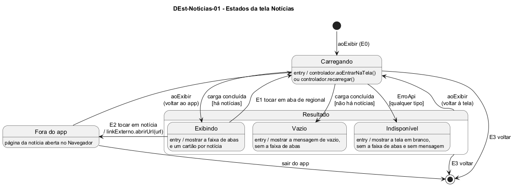

# DEst-Noticias-01 – Estados da tela Notícias

| Campo | Valor |
|---|---|
| **Código** | `DEst-Noticias-01` |
| **Título** | Estados da tela Notícias |
| **Autor(a)** | José Eduardo Gontijo de Carvalho (Pessoa C) |
| **Revisor(a)** | Phablo Tavares Paixão (Pessoa D) |
| **Status** | Em produção |
| **Rastreia para** | `DIhc-Noticias-01`, `DEst-Comum-01`, `DCla-Comum-03`, `DSeq-Noticias-01`, `DSeq-Noticias-02`, `DSeq-Noticias-03`, `ECA-Noticias-01` |

## Diagrama

Fonte: [`DEst-Noticias-01.puml`](DEst-Noticias-01.puml)

## Descrição

Especifica como a tela Notícias reage a cada evento de interação do protótipo (`DIhc-Noticias-01`). Os estados Carregando, Exibindo, Vazio e Indisponível são os do ciclo genérico de `DEst-Comum-01`; aqui, Exibindo, Vazio e Indisponível ficam reunidos no estado composto `Resultado`. A tela de Notícias acrescenta:

- a ação que leva a nova carga: **E1**, tocar em uma aba de regional. Só ocorre a partir de **Exibindo**, o único estado em que a faixa de abas aparece: no estado Indisponível a captura 31 (versão 3.2.0, modo avião) mostra a tela sem abas, e o estado Vazio segue o mesmo padrão por analogia com Eventos (P-NO-1, P-NO-8, P-NO-9). Como a mudança de regional altera o filtro, E1 leva a Carregando;
- o estado **Fora do app**: ao tocar em uma notícia (**E2**), o Navegador é aberto na página dela e o app fica em segundo plano (P-NO-3). Ao voltar, `aoExibir` leva a Carregando, e as notícias são buscadas de novo (sem cache), com a regional mantida;
- o evento **E3**, tocar na seta de voltar, que encerra a tela em qualquer estado e descarta a regional escolhida e as notícias em memória. A barra de título, com a seta, é fixa e fica à vista em todos os estados (capturas 18 e 31).

**Tabela 1 – Transições da tela Notícias**

| Origem | Evento | Condição | Destino |
|---|---|---|---|
| (início) | `aoExibir` (E0) | – | Carregando |
| Carregando | carga concluída | há notícias | Exibindo |
| Carregando | carga concluída | não há notícias | Vazio |
| Carregando | `ErroApi` | qualquer tipo | Indisponível |
| Exibindo | E1 | – | Carregando |
| Resultado (Exibindo, Vazio ou Indisponível) | `aoExibir` (voltar à tela) | – | Carregando |
| Exibindo | E2 | – | Fora do app |
| Fora do app | `aoExibir` (voltar ao app) | – | Carregando |
| Carregando ou Resultado | E3 | – | (fim) |
| Fora do app | sair do app | – | (fim) |

**Tabela 2 – O que a tela mostra em cada estado**

| Estado | Barra de título (fixa) | Faixa de abas | Corpo | Base |
|---|---|---|---|---|
| Carregando | Sim | Não (presumido) | Indicador de carregamento (presumido) | Não observado (P-NO-9) |
| Exibindo | Sim | Sim, rola junto com a lista | Um cartão por notícia | Capturas 16 e 18 |
| Vazio | Sim | Não (presumido, como em Eventos) | Mensagem de vazio genérica do Comum (presumida) | Não observado (P-NO-9) |
| Indisponível | Sim | Não | **Em branco, sem mensagem** | Captura 31 (modo avião, P-NO-8) |

No estado Indisponível o `ErroApi` é tratado no controlador do Comum, como em toda tela (`DEst-Comum-01`); o que Notícias faz de diferente é só a apresentação: a tela fica em branco. Como a faixa de abas não aparece em Vazio nem em Indisponível, o usuário só sai desses estados voltando ao menu (E3) ou saindo e entrando de novo na tela (E0); não há outra aba para tocar. Toda notícia tem endereço (`DD-Noticias-01`), então não há transição de E2 sem destino. As regras ativas de cada transição estão em `ECA-Noticias-01`.

As premissas P-NO-1, P-NO-3, P-NO-8 e P-NO-9 estão na tabela de [`Noticias/README.md`](README.md), com o que as capturas de tela do app (versão 3.2.0) confirmaram e o que falta confirmar. O estado Indisponível foi observado só em modo avião (`SEM_CONEXAO`); presume-se o mesmo para os demais tipos de `ErroApi`, que o controlador trata do mesmo modo.

## Referências

INSTITUTE OF ELECTRICAL AND ELECTRONICS ENGINEERS. **Guide to the Software Engineering Body of Knowledge – SWEBOK v4**. Cap. 11 (Software Engineering Models and Methods). IEEE, 2024.

ANTHROPIC. **Claude Code**. Assistente de IA. Disponível em: claude.ai/code. Acesso em: 30 out. 2026. Uso: apoio à redação e aos diagramas, a partir das instruções, das capturas de tela e das correções do autor (resumo em `IA/registro-C.md`). Questão: Apêndice <X>, Seção <X.1>.

---

## Registro de revisão

| Data | Revisor(a) | Situação | Observações |
|---|---|---|---|
| | | | |
