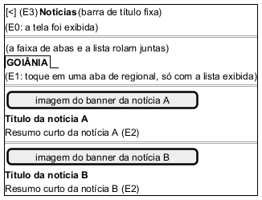

# DIhc-Noticias-01 – Protótipo da tela Notícias

| Campo | Valor |
|---|---|
| **Código** | `DIhc-Noticias-01` |
| **Título** | Protótipo da tela Notícias |
| **Autor(a)** | José Eduardo Gontijo de Carvalho (Pessoa C) |
| **Revisor(a)** | Phablo Tavares Paixão (Pessoa D) |
| **Status** | Em produção |
| **Rastreia para** | `DCdu-Noticias-01`, `DAtv-Noticias-01`, `DAtv-Noticias-02`, `DEst-Noticias-01`, `DCla-Noticias-01`, `DSeq-Noticias-01`, `DSeq-Noticias-02`, `DSeq-Noticias-03` |

## Diagrama

Fonte: [`DIhc-Noticias-01.puml`](DIhc-Noticias-01.puml)

## Descrição

Protótipo da tela Notícias em PlantUML Salt, conforme as capturas 5, 11, 16 e 18 da versão 3.2.0 (iPhone) e a captura 31 (modo avião). De cima para baixo:

- **barra de título**, com a seta de voltar e o título "Notícias". É **fixa**: continua à vista quando a lista rola (captura 18) e em todos os estados da tela (captura 31);
- **faixa de abas de regional**, logo abaixo da barra: só a aba "GOIÂNIA" aparece nas capturas, sublinhada e selecionada. Não se sabe se existem outras regionais (P-NO-1, P-NO-6) nem se "GOIÂNIA" é a primeira aba da faixa ou a única (P-NO-2); por isso o desenho mostra só essa aba e não inventa outras. A faixa **rola junto com a lista**: na captura 18 ela já saiu da tela, e a barra de título permanece. Ela só aparece quando a lista é exibida (estado Exibindo): no estado indisponível ela não existe (captura 31, P-NO-8);
- **lista de notícias**: cada notícia é um cartão com a imagem de banner, o título em negrito e o texto de resumo, nessa ordem (o resumo aparece em itálico em alguns cartões e em fonte normal em outros). **A data de publicação não aparece no cartão**: ela só é vista na página da notícia, aberta no navegador (capturas 12 e 20: portal ufg.br, trilha "INÍCIO > NOTÍCIAS", título e "Em 29/10/26 18:18."). A ordem da lista não é verificável nas capturas (P-NO-5).

Os dados do desenho são ilustrativos. Não há tela de detalhe: tocar no cartão abre a página da notícia no Navegador (P-NO-3); a página mostra título, data e hora, texto e os créditos "Texto:" e "Foto de capa:", que ficam fora do modelo do app. O toque em si não foi capturado, só o resultado.

**Estado indisponível (captura 31, modo avião).** A barra de título e a seta de voltar continuam, e o corpo da tela fica **totalmente em branco: sem a faixa de abas e sem mensagem** (P-NO-8). Esse é o estado `INDISPONIVEL` do Comum (`DEst-Comum-01`); o que muda é só a apresentação, e não há protótipo separado para ele. Os estados carregando e vazio não foram capturados: presume-se o indicador de carregamento e a mensagem de vazio genérica do Comum, sem a faixa de abas, como em Eventos e no indisponível (P-NO-9). Como as abas só existem com a lista exibida, o evento E1 só ocorre nesse estado.

**Tabela 1 – Eventos de interação da tela**

| Rótulo | Elemento | Gesto | Efeito | Operação da tela | Atividade | Diagrama de sequência |
|---|---|---|---|---|---|---|
| E0 | Tela (ao ser exibida) | Entrada na tela | Na entrada pelo menu inicial, seleciona a primeira aba de regional e carrega as notícias; no retorno do Navegador, recarrega com a regional mantida | `aoExibir()` | `DAtv-Noticias-01`, A1 | `DSeq-Noticias-01`, `DSeq-Noticias-03` |
| E1 | Aba de regional (só com a lista exibida) | Toque | Seleciona a regional e recarrega a lista | `aoEscolherRegional(regional)` | `DAtv-Noticias-01`, A2 | `DSeq-Noticias-02` |
| E2 | Cartão de notícia | Toque | Abre a página da notícia no Navegador | `aoTocarNoticia(noticia)` | `DAtv-Noticias-02`, A1 | `DSeq-Noticias-03` |
| E3 | Seta de voltar (barra de título) | Toque | Encerra a tela, descarta a regional escolhida e as notícias em memória e volta ao menu inicial | `aoVoltar()` | `DAtv-Noticias-01` (passo final) | (passo trivial, sem diagrama de sequência) |

O evento E0 ocorre sempre que a tela é exibida, inclusive ao voltar do Navegador, pois o app não guarda cache. Só na entrada pelo menu inicial a regional é reiniciada (primeira aba); no retorno do Navegador ela é mantida. A seta de voltar (E3) está disponível em todos os estados, inclusive no indisponível.

As premissas P-NO-1, P-NO-2, P-NO-3, P-NO-5, P-NO-6, P-NO-8 e P-NO-9 estão na tabela de [`Noticias/README.md`](README.md), com o que as capturas de tela do app (versão 3.2.0) confirmaram e o que falta confirmar.

## Referências

INSTITUTE OF ELECTRICAL AND ELECTRONICS ENGINEERS. **Guide to the Software Engineering Body of Knowledge – SWEBOK v4**. Cap. 11 (Software Engineering Models and Methods). IEEE, 2024.

ANTHROPIC. **Claude Code**. Assistente de IA. Disponível em: claude.ai/code. Acesso em: 30 out. 2026. Uso: apoio à redação e aos diagramas, a partir das instruções, das capturas de tela e das correções do autor (resumo em `IA/registro-C.md`). Questão: Apêndice <X>, Seção <X.1>.

---

## Registro de revisão

| Data | Revisor(a) | Situação | Observações |
|---|---|---|---|
| | | | |
