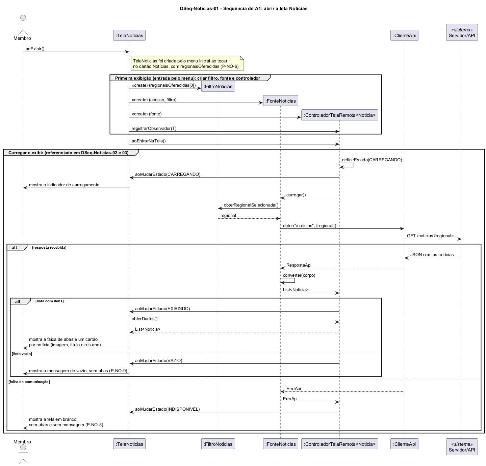

# DSeq-Noticias-01 – Sequência de A1: abrir a tela Notícias

| Campo | Valor |
|---|---|
| **Código** | `DSeq-Noticias-01` |
| **Título** | Sequência de A1: abrir a tela Notícias |
| **Autor(a)** | José Eduardo Gontijo de Carvalho (Pessoa C) |
| **Revisor(a)** | Phablo Tavares Paixão (Pessoa D) |
| **Status** | Em produção |
| **Rastreia para** | `DAtv-Noticias-01`, `DIhc-Noticias-01`, `DCla-Noticias-01`, `DCla-Noticias-02`, `Contrato-Noticias-01`, `DCla-Comum-02`, `DCla-Comum-03`, `DEst-Comum-01` |

## Diagrama

Fonte: [`DSeq-Noticias-01.puml`](DSeq-Noticias-01.puml)

## Descrição

Detalha a atividade A1 de `DAtv-Noticias-01` (evento E0 de `DIhc-Noticias-01`): o usuário abre a tela e o app carrega as notícias da regional inicial. A primeira mensagem é a operação `aoExibir()` da `TelaNoticias`. A tela foi criada pelo menu inicial ao toque no cartão Notícias, recebendo `regionaisOferecidas`, a lista fixa de regionais do app (P-NO-6). Na primeira exibição (entrada pelo menu), ela cria o `FiltroNoticias` com a primeira regional da lista (P-NO-2), cria a `FonteNoticias` com o acesso à API e o filtro (que faz o papel de `IFiltroNoticias`), cria o `ControladorTelaRemota<Noticia>` do Comum com essa fonte e se registra nele como observador (`registrarObservador`). Só então chama `aoEntrarNaTela()` (`DCla-Comum-03`).

O controlador pede a carga à `FonteNoticias`, que lê a regional selecionada, consulta a API por meio de `IAcessoApi` (`DCla-Comum-02`) e converte a resposta em notícias. O desfecho define o estado da tela, segundo o ciclo genérico de `DEst-Comum-01`: `EXIBINDO` (a tela lê a lista com `obterDados()` e mostra a faixa de abas e um cartão por notícia), `VAZIO` (mensagem de vazio, sem abas) ou `INDISPONIVEL` (qualquer `ErroApi`, tratado no controlador e que não chega à tela; a tela fica em branco, sem abas e sem mensagem, como na captura 31 em modo avião, P-NO-8). A apresentação do estado vazio não foi capturada e segue o Comum, sem abas por analogia com Eventos (P-NO-9); a faixa de abas só aparece em `EXIBINDO`. A rota `/noticias` e o parâmetro `regional` são premissa de projeto (P-NO-4).

O mesmo grupo "Carregar e exibir" é referenciado nos diagramas `DSeq-Noticias-02` e `03`. Os contratos das operações estão em `Contrato-Noticias-01`.

As premissas P-NO-2, P-NO-4, P-NO-6, P-NO-8 e P-NO-9 estão na tabela de [`Noticias/README.md`](README.md), com o que as capturas de tela do app (versão 3.2.0) confirmaram e o que falta confirmar.

## Referências

INSTITUTE OF ELECTRICAL AND ELECTRONICS ENGINEERS. **Guide to the Software Engineering Body of Knowledge – SWEBOK v4**. Cap. 11 (Software Engineering Models and Methods). IEEE, 2024.

ANTHROPIC. **Claude Code**. Assistente de IA. Disponível em: claude.ai/code. Acesso em: 30 out. 2026. Uso: apoio à redação e aos diagramas, a partir das instruções, das capturas de tela e das correções do autor (resumo em `IA/registro-C.md`). Questão: Apêndice <X>, Seção <X.1>.

---

## Registro de revisão

| Data | Revisor(a) | Situação | Observações |
|---|---|---|---|
| | | | |
