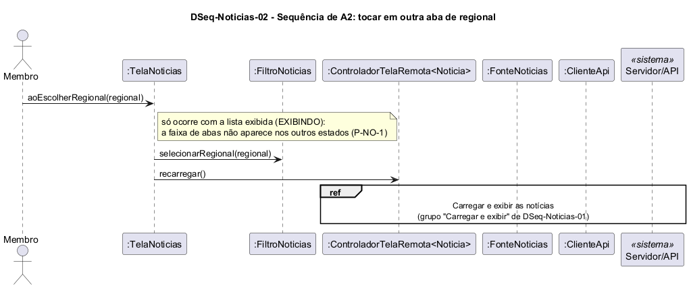

# DSeq-Noticias-02 – Sequência de A2: tocar em outra aba de regional

| Campo | Valor |
|---|---|
| **Código** | `DSeq-Noticias-02` |
| **Título** | Sequência de A2: tocar em outra aba de regional |
| **Autor(a)** | José Eduardo Gontijo de Carvalho (Pessoa C) |
| **Revisor(a)** | Phablo Tavares Paixão (Pessoa D) |
| **Status** | Em produção |
| **Rastreia para** | `DAtv-Noticias-01`, `DIhc-Noticias-01`, `DSeq-Noticias-01`, `DCla-Noticias-01`, `Contrato-Noticias-01`, `DCla-Comum-03` |

## Diagrama

Fonte: [`DSeq-Noticias-02.puml`](DSeq-Noticias-02.puml)

## Descrição

Detalha a atividade A2 de `DAtv-Noticias-01` (evento E1 de `DIhc-Noticias-01`). **O evento só ocorre com a lista exibida (estado `EXIBINDO`)**, pois a faixa de abas só aparece nesse estado: no estado indisponível a tela fica em branco, sem abas (captura 31, P-NO-1). A primeira mensagem é `aoEscolherRegional(regional)` da `TelaNoticias`. A tela grava a nova regional no `FiltroNoticias` (`selecionarRegional`) e pede ao controlador `recarregar()` (`DCla-Comum-03`); a regional mudou, então os dados em memória não servem mais. O ciclo "Carregar e exibir" é o mesmo do `DSeq-Noticias-01`: a `FonteNoticias` lê a regional do filtro e chama a API de novo, com os mesmos desfechos (`EXIBINDO`, `VAZIO` ou `INDISPONIVEL`). Só existe a aba "GOIÂNIA" nas capturas, então a troca de aba é o comportamento esperado de uma faixa de abas e não foi observada, nem o que a tela mostra durante a nova carga (P-NO-1).

A premissa P-NO-1 está na tabela de [`Noticias/README.md`](README.md), com o que as capturas de tela do app (versão 3.2.0) confirmaram e o que falta confirmar.

## Referências

INSTITUTE OF ELECTRICAL AND ELECTRONICS ENGINEERS. **Guide to the Software Engineering Body of Knowledge – SWEBOK v4**. Cap. 11 (Software Engineering Models and Methods). IEEE, 2024.

ANTHROPIC. **Claude Code**. Assistente de IA. Disponível em: claude.ai/code. Acesso em: 30 out. 2026. Uso: apoio à redação e aos diagramas, a partir das instruções, das capturas de tela e das correções do autor (resumo em `IA/registro-C.md`). Questão: Apêndice <X>, Seção <X.1>.

---

## Registro de revisão

| Data | Revisor(a) | Situação | Observações |
|---|---|---|---|
| | | | |
