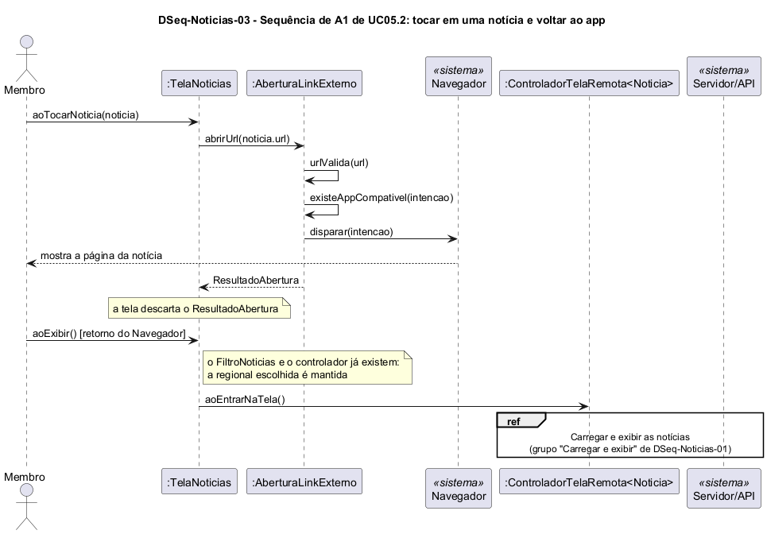

# DSeq-Noticias-03 – Sequência de A1 de UC05.2: tocar em uma notícia e voltar ao app

| Campo | Valor |
|---|---|
| **Código** | `DSeq-Noticias-03` |
| **Título** | Sequência de A1 de UC05.2: tocar em uma notícia e voltar ao app |
| **Autor(a)** | José Eduardo Gontijo de Carvalho (Pessoa C) |
| **Revisor(a)** | Phablo Tavares Paixão (Pessoa D) |
| **Status** | Em produção |
| **Rastreia para** | `DAtv-Noticias-02`, `DIhc-Noticias-01`, `DSeq-Noticias-01`, `DCla-Noticias-01`, `DCla-Comum-01`, `Contrato-Noticias-01`, `ECA-Noticias-01` |

## Diagrama

Fonte: [`DSeq-Noticias-03.puml`](DSeq-Noticias-03.puml)

## Descrição

Detalha a atividade A1 de `DAtv-Noticias-02` (evento E2 de `DIhc-Noticias-01`). A primeira mensagem é `aoTocarNoticia(noticia)` da `TelaNoticias`. A tela chama `ILinkExterno.abrirUrl(noticia.url)` (`DCla-Comum-01`), que valida o endereço, procura um app compatível e entrega a intenção ao Navegador; o resultado é descartado, pois o app atual não mostra mensagem de falha. Toda notícia tem `url` (`DD-Noticias-01`), por isso não há caso sem endereço, ao contrário de Eventos. O Navegador mostra a página da notícia no portal da UFG (capturas 12 e 20 da versão 3.2.0); o resultado foi observado, mas o toque no cartão, em si, não foi capturado (P-NO-3).

Ao voltar do Navegador, a tela é exibida de novo e `aoExibir()` é chamado outra vez (retorno, `ECA-NO-01`). Como a tela já tem o `FiltroNoticias` e o controlador, nada é recriado: a regional escolhida é mantida e só `aoEntrarNaTela()` é chamado, reutilizando o grupo "Carregar e exibir" do `DSeq-Noticias-01`. As notícias são buscadas de novo, pois o app não guarda cache.

A premissa P-NO-3 está na tabela de [`Noticias/README.md`](README.md), com o que as capturas de tela do app (versão 3.2.0) confirmaram e o que falta confirmar.

## Referências

INSTITUTE OF ELECTRICAL AND ELECTRONICS ENGINEERS. **Guide to the Software Engineering Body of Knowledge – SWEBOK v4**. Cap. 11 (Software Engineering Models and Methods). IEEE, 2024.

ANTHROPIC. **Claude Code**. Assistente de IA. Disponível em: claude.ai/code. Acesso em: 30 out. 2026. Uso: apoio à redação e aos diagramas, a partir das instruções, das capturas de tela e das correções do autor (resumo em `IA/registro-C.md`). Questão: Apêndice <X>, Seção <X.1>.

---

## Registro de revisão

| Data | Revisor(a) | Situação | Observações |
|---|---|---|---|
| | | | |
