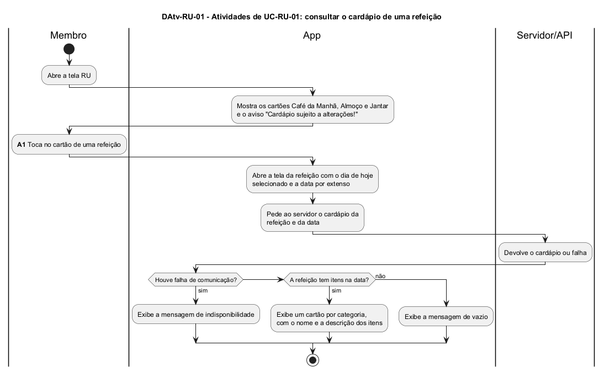

# DAtv-RU-01 – Atividades de UC-RU-01: consultar o cardápio de uma refeição

| Campo | Valor |
|---|---|
| **Código** | `DAtv-RU-01` |
| **Título** | Atividades de UC-RU-01: consultar o cardápio de uma refeição |
| **Autor(a)** | José Eduardo Gontijo de Carvalho (Pessoa C) |
| **Revisor(a)** | Phablo Tavares Paixão (Pessoa D) |
| **Status** | Em produção (primeira versão) |
| **Rastreia para** | `DCdu-RU-01`, `DIhc-RU-01`, `DIhc-RU-02`, `DEst-Comum-01` |

## Diagrama

Fonte: [`DAtv-RU-01.puml`](DAtv-RU-01.puml)

## Descrição

Fluxo do caso de uso UC-RU-01 em raias: Membro, App e Servidor/API. A única ação em que o usuário interage com o app é **A1 – tocar no cartão de uma refeição**; o diagrama de sequência dela (`DSeq-RU-01`) será produzido na etapa de classes e sequências, junto com o componente da funcionalidade. A chamada ao servidor e a exibição do resultado fazem parte dessa atividade (contrato-base, seção 6). Os desfechos seguem o ciclo genérico de `DEst-Comum-01`. A tela RU, com os três cartões, é estática: não há chamada ao servidor até o usuário escolher uma refeição (P-RU-1).

As premissas `P-RU-n` citadas estão listadas, com o que as capturas de tela do app (versão 3.2.0) confirmaram e o que falta confirmar, em [`RU/README.md`](README.md).

## Referências

INSTITUTE OF ELECTRICAL AND ELECTRONICS ENGINEERS. **Guide to the Software Engineering Body of Knowledge – SWEBOK v4**. Cap. 11 (Software Engineering Models and Methods). IEEE, 2024.

---

## Registro de revisão

| Data | Revisor(a) | Situação | Observações |
|---|---|---|---|
| | | | |
