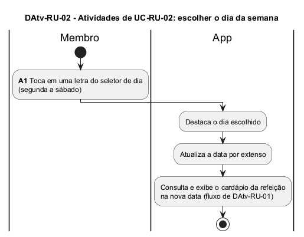

# DAtv-RU-02 – Atividades de UC-RU-02: escolher o dia da semana

| Campo | Valor |
|---|---|
| **Código** | `DAtv-RU-02` |
| **Título** | Atividades de UC-RU-02: escolher o dia da semana |
| **Autor(a)** | José Eduardo Gontijo de Carvalho (Pessoa C) |
| **Revisor(a)** | Phablo Tavares Paixão (Pessoa D) |
| **Status** | Em produção (primeira versão) |
| **Rastreia para** | `DCdu-RU-01`, `DAtv-RU-01`, `DIhc-RU-02` |

## Diagrama

Fonte: [`DAtv-RU-02.puml`](DAtv-RU-02.puml)

## Descrição

Fluxo do caso de uso UC-RU-02. A ação de interação é **A1 – tocar em uma letra do seletor de dia**, cujo diagrama de sequência (`DSeq-RU-02`) será produzido na etapa de classes e sequências. Depois de destacar o dia e atualizar a data por extenso, o app repete a consulta do cardápio já descrita em `DAtv-RU-01`.

As premissas `P-RU-n` citadas estão listadas, com o que as capturas de tela do app (versão 3.2.0) confirmaram e o que falta confirmar, em [`RU/README.md`](README.md).

## Referências

INSTITUTE OF ELECTRICAL AND ELECTRONICS ENGINEERS. **Guide to the Software Engineering Body of Knowledge – SWEBOK v4**. Cap. 11 (Software Engineering Models and Methods). IEEE, 2024.

---

## Registro de revisão

| Data | Revisor(a) | Situação | Observações |
|---|---|---|---|
| | | | |
