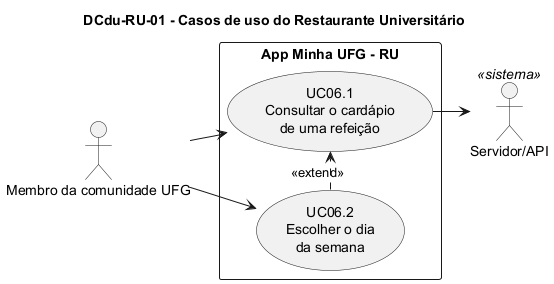

# DCdu-RU-01 – Casos de uso do Restaurante Universitário

| Campo | Valor |
|---|---|
| **Código** | `DCdu-RU-01` |
| **Título** | Casos de uso do Restaurante Universitário |
| **Autor(a)** | José Eduardo Gontijo de Carvalho (Pessoa C) |
| **Revisor(a)** | Phablo Tavares Paixão (Pessoa D) |
| **Status** | Em produção |
| **Rastreia para** | `DCdu-Geral-01`, `DAtv-RU-01`, `DAtv-RU-02`, `DIhc-RU-01`, `DIhc-RU-02`, `DEst-Comum-01` |

## Diagrama

Fonte: [`DCdu-RU-01.puml`](DCdu-RU-01.puml)

## Descrição

Detalha o caso de uso macro UC06 "Consultar cardápio do RU" do `DCdu-Geral-01` em dois casos de uso, `UC06.1` e `UC06.2`. O ator primário é o Membro da comunidade UFG (anônimo). O único ator externo é o Servidor/API, que fornece o cardápio cadastrado pelo painel web (o painel não interage com o app e aparece só no `DImp-Geral-01`). **O Servidor/API participa só do UC06.1:** ao abrir a tela de uma refeição, o app busca o cardápio da semana inteira dessa refeição numa única chamada (P-RU-3); o UC06.2 apenas filtra, na memória do aparelho, os dados já carregados, como a Rádio faz com a programação (`DCdu-Radio-01`). O RU não abre nenhum aplicativo externo. O cardápio é único para todos os restaurantes da UFG, por isso o app não pede a escolha de restaurante nem de regional.

O app tem duas telas nesta funcionalidade (capturas 1, 13, 14 e 17, 22 a 27 e 30, versão 3.2.0). A tela **RU** tem um cartão com imagem para cada refeição (Café da Manhã, Almoço e Jantar) e o aviso "Cardápio sujeito a alterações!" (P-RU-1). A tela da **refeição escolhida** mostra a data por extenso, os itens do cardápio em cartões por categoria (P-RU-5) e, na borda esquerda, o seletor vertical de dia da semana (letras S, T, Q, Q, S, S, de segunda a sábado; no Jantar, cinco letras, de segunda a sexta: P-RU-4). A barra de título e o fundo da tela têm a cor do dia selecionado (P-RU-7). As duas telas têm seta de voltar na barra de título (P-RU-11).

**Tabela 1 – Casos de uso de RU**

| Código | Caso de uso | Objetivo do usuário | Ator externo |
|---|---|---|---|
| UC06.1 | Consultar o cardápio de uma refeição | Ver o que será servido em uma refeição, com a semana carregada de uma vez | Servidor/API |
| UC06.2 | Escolher o dia da semana | Ver o cardápio da mesma refeição em outro dia da semana | – |

**UC06.1 – Consultar o cardápio de uma refeição**

- *Pré-condição:* o usuário tocou no cartão RU do menu inicial (E7 do `DIhc-Inicio-01`).
- *Fluxo principal:*
  1. O app mostra os três cartões de refeição e o aviso de que o cardápio está sujeito a alterações (P-RU-1, P-RU-2).
  2. O usuário toca no cartão de uma refeição.
  3. O app abre a tela da refeição e pede ao servidor o cardápio da semana inteira da refeição (P-RU-3, P-RU-10).
  4. O app seleciona o dia de hoje (P-RU-13) e mostra a barra e o fundo na cor do dia (P-RU-7), a data por extenso e o seletor de dia (P-RU-4).
  5. O app mostra um cartão para cada categoria de item do dia selecionado, com o nome da categoria e a descrição dos itens (P-RU-5).
- *Fluxos alternativos:*
  - **A1 (semana sem refeições):** o servidor não devolve nenhuma refeição; o app mostra a mensagem genérica de vazio (P-RU-9).
  - **A2 (sem resposta):** sem internet ou servidor indisponível; o app mostra a ilustração com a mensagem "Cardápio indisponível.", com barra azul e sem data nem seletor (P-RU-8).
  - **A3 (dia sem itens):** a semana tem refeições, mas não há itens para o dia selecionado; o app mostra a mensagem genérica de vazio, mantendo a data e o seletor (P-RU-9).
  - **A4 (hoje fora do seletor):** hoje é domingo, ou é sábado e a refeição é o Jantar, dias que não têm letra no seletor; o app seleciona a segunda-feira (P-RU-13).
- *Pós-condição:* a tela mostra o cardápio do dia selecionado da refeição escolhida, ou a mensagem de vazio ou de indisponibilidade, e o cardápio da semana fica em memória.

**UC06.2 – Escolher o dia da semana** (estende UC06.1)

- *Pré-condição:* a tela de uma refeição mostra o cardápio da semana (estado Exibindo; o seletor só aparece nesse estado: P-RU-8, P-RU-9).
- *Ponto de extensão:* depois do passo 5 do UC06.1 (ou depois de A3 ou A4).
- *Fluxo principal:*
  1. O usuário toca em uma letra do seletor de dia (P-RU-4).
  2. O app destaca o dia escolhido, muda a cor da barra e do fundo e atualiza a data por extenso (P-RU-7).
  3. O app filtra o cardápio da semana, já em memória, e mostra os cartões do dia escolhido, sem consultar o servidor (P-RU-3).
- *Fluxos alternativos:* **A1 (dia sem itens):** o app mostra a mensagem genérica de vazio (P-RU-9).
- *Pós-condição:* o seletor destaca o dia escolhido e a tela mostra o cardápio da refeição nesse dia, sem nova chamada ao servidor.

As mensagens de vazio não aparecem nas capturas e seguem o ciclo genérico de tela remota do Comum (`DEst-Comum-01`); a de indisponibilidade foi observada (captura 30). Voltar pela seta da barra de título não é caso de uso: é navegação, modelada nos protótipos, nos estados e nos contratos. As premissas `P-RU-n` citadas estão listadas, com o que as capturas de tela do app (versão 3.2.0) e o autor confirmaram e o que falta confirmar, em [`RU/README.md`](README.md).

## Referências

INSTITUTE OF ELECTRICAL AND ELECTRONICS ENGINEERS. **Guide to the Software Engineering Body of Knowledge – SWEBOK v4**. Cap. 11 (Software Engineering Models and Methods). IEEE, 2024.

ANTHROPIC. **Claude Code**. Assistente de IA. Disponível em: claude.ai/code. Acesso em: 30 out. 2026. Uso: apoio à redação e aos diagramas, a partir das instruções, das capturas de tela e das correções do autor (resumo em `IA/registro-C.md`). Questão: Apêndice <X>, Seção <X.1>.

---

## Registro de revisão

| Data | Revisor(a) | Situação | Observações |
|---|---|---|---|
| | | | |
